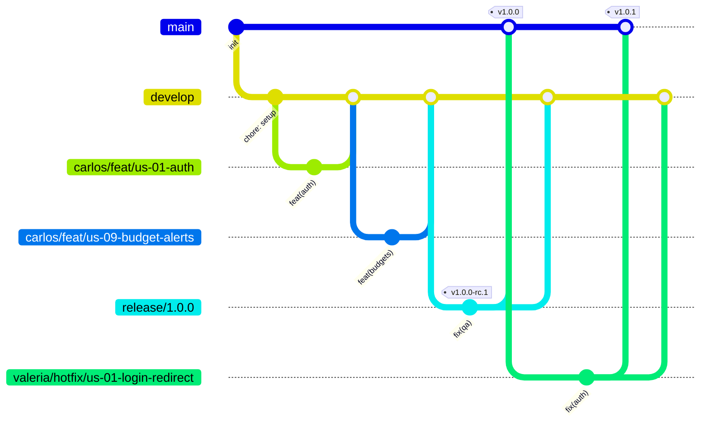

<div align="center">

# 🤝 Guía de contribución · Mincome

### Definition of Done, convenciones de nombres, ramas, commits y versionado

<br/>


</div>

<br/>

> [!IMPORTANT]
> Esta guía aplica a todo el equipo. Si surge un caso que no está cubierto, se acuerda en equipo y se agrega aquí con un commit `docs(contributing): ...`.

<br/>

## 📑 Índice

<div align="center">

| 📏 Estándares | 🌿 Flujo en Git | 📦 Versiones y repositorio |
|:--|:--|:--|
| `01` [Definition of Done](#-definition-of-done) | `03` [Estrategia de ramas](#-estrategia-de-ramas) | `06` [Versionado](#-versionado) |
| `02` [Convenciones de nombres](#-convenciones-de-nombres) | `04` [Commits](#-commits) | `07` [Qué nunca se sube](#-qué-nunca-se-sube) |
| | `05` [Pull requests y code review](#-pull-requests-y-code-review) | `08` [Herramientas que lo hacen cumplir](#-herramientas-que-lo-hacen-cumplir) |

</div>

<br/>

## ✅ Definition of Done

Una tarea solo se mueve a **Hecho** en el tablero cuando cumple **todo** lo de su nivel. Hay tres niveles: tarea, sprint y entrega final.

### Nivel 1 · Tarea (TSK) y su pull request

**🎯 Funcionalidad**
- [ ] Cumple los criterios de aceptación del RF vinculado y el DoD específico de su TSK en el plan de tareas.
- [ ] Si toca interfaz, funciona en web y en móvil (Capacitor).
- [ ] Si toca interfaz, es responsiva sin desbordamientos horizontales (RNF6) y muestra confirmación al guardar, actualizar o eliminar (RNF7).

**🧹 Código**
- [ ] Sigue las [convenciones de nombres](#-convenciones-de-nombres) de esta guía.
- [ ] Pasa ESLint y Prettier sin errores ni warnings.
- [ ] Compila con TypeScript en modo `strict`, sin `any` explícito ni `@ts-ignore` sin justificar en un comentario.
- [ ] Sin `console.log` de depuración ni código comentado.

**🧪 Pruebas**
- [ ] Toda operación aritmética (saldos, apartados, presupuestos, proyecciones, días de corte) tiene pruebas unitarias (R1).
- [ ] Todas las pruebas pasan en local y en CI.

**🔒 Seguridad y datos**
- [ ] Valida la información en frontend **y** backend, según la sección de validación del README.
- [ ] Ningún DTO, entidad ni formulario incluye CVV, NIP o número completo de tarjeta (RNF3).
- [ ] Los endpoints de listados están paginados desde el servidor (RNF5).
- [ ] Sin secretos ni llaves en el código.

**🔀 Proceso**
- [ ] La rama sigue el [formato de nombre](#formato-del-nombre) con el ID de su user story.
- [ ] El PR tiene título en formato [Conventional Commits](#-commits), una descripción completa de los cambios y referencia su user story y su TSK.
- [ ] Tiene al menos una aprobación de otro integrante y todos los comentarios resueltos.
- [ ] Está fusionado en `develop` y la rama se eliminó.
- [ ] La documentación se actualizó si cambió el uso, la API o la configuración.
- [ ] La tarjeta está en **Hecho** en el tablero Scrum.

### Nivel 2 · Sprint

- [ ] Todas las tareas comprometidas cumplen el nivel 1, o regresan al backlog con justificación.
- [ ] `develop` compila y todas las pruebas pasan.
- [ ] QA ejecutó los casos de la matriz de pruebas que corresponden a lo entregado (TSK-15).
- [ ] Se hizo la demo en la revisión del sprint.
- [ ] Lo entregado se liberó a `main` con su tag y el CHANGELOG actualizado (ver [Versionado](#-versionado)).

### Nivel 3 · Entrega final (Hito 3)

- [ ] Se cumple todo el nivel 2.
- [ ] La matriz de pruebas QA está ejecutada al 100 % y sin errores críticos abiertos (TSK-15).
- [ ] La batería de prompts del asistente está ejecutada y el aviso "El chatbot es una IA y puede equivocarse" es visible (TSK-16).
- [ ] El frontend está desplegado en Amazon S3 + CloudFront bajo HTTPS (TSK-14).
- [ ] El build móvil de Capacitor está generado e instalable.
- [ ] `main` tiene el tag `v1.0.0` y su release publicado en GitHub.

<div align="right"><a href="#-índice">⬆️ Volver al índice</a></div>

## 🔤 Convenciones de nombres

### 🌐 Idioma

| Qué | Idioma |
|---|---|
| Código: variables, funciones, clases, archivos, tablas, endpoints y nombres de ramas | 🇺🇸 Inglés |
| Mensajes de commit, pull requests y documentación | 🇲🇽 Español |
| Textos visibles para el usuario | 🇲🇽 Español |

> [!NOTE]
> El código va en inglés porque los frameworks y librerías ya lo están; así se evitan mezclas como `getUsuarios()`. Por eso `procesarConsulta()` del anteproyecto queda como `processQuery()`.

### 🟦 TypeScript (frontend y backend)

| Elemento | Case | Ejemplo |
|---|---|---|
| Variables y parámetros | `camelCase` | `freeBalance`, `cutoffDay` |
| Funciones y métodos | `camelCase`, empiezan con verbo | `calculateDaysUntilDue()`, `processQuery()` |
| Booleanos | `camelCase` con prefijo `is` / `has` / `can` / `should` | `isOverBudget`, `hasCards` |
| Clases | `PascalCase` | `TransactionsService`, `ChatbotFacade` |
| Interfaces y tipos | `PascalCase`, sin prefijo `I` | `Transaction`, `BudgetAlert` |
| Enums | `PascalCase` el nombre, `UPPER_SNAKE_CASE` los miembros | `TransactionType.FIXED_EXPENSE` |
| Constantes globales | `UPPER_SNAKE_CASE` | `PAGE_SIZE = 20`, `BUDGET_WARNING_THRESHOLD = 0.8` |
| Genéricos | `T` o `PascalCase` con prefijo `T` | `T`, `TEntity` |
| Carpetas | `kebab-case` | `budget-limits/` |

### ⚛️ React

| Elemento | Case | Ejemplo |
|---|---|---|
| Componentes | `PascalCase` | `BudgetProgressBar` |
| Archivo de componente | `PascalCase.tsx` | `BudgetProgressBar.tsx` |
| Hooks | `camelCase` con prefijo `use` | `useBudgetAlerts.ts` |
| Props | Nombre del componente + `Props` | `BudgetProgressBarProps` |
| Manejadores de eventos | `handle` + evento dentro del componente, `on` + evento como prop | `handleSubmit`, `onDelete` |
| Otros archivos `.ts` | `kebab-case` | `api-client.ts` |

### 🐱 NestJS

Archivos en `kebab-case` con el sufijo de su tipo, igual que los genera el CLI de Nest. Los módulos van en plural.

| Elemento | Archivo | Clase |
|---|---|---|
| Módulo | `transactions.module.ts` | `TransactionsModule` |
| Controlador | `transactions.controller.ts` | `TransactionsController` |
| Servicio | `transactions.service.ts` | `TransactionsService` |
| Repositorio | `transactions.repository.ts` | `TransactionsRepository` |
| DTO | `create-transaction.dto.ts` | `CreateTransactionDto` |
| Entidad | `transaction.entity.ts` | `Transaction` |
| Guard | `auth.guard.ts` | `AuthGuard` |
| Prueba unitaria | `transactions.service.spec.ts` | — |
| Prueba e2e | `transactions.e2e-spec.ts` | — |

### 🐘 Base de datos (PostgreSQL)

| Elemento | Convención | Ejemplo |
|---|---|---|
| Tablas | `snake_case`, plural | `transactions`, `budget_limits` |
| Columnas | `snake_case` | `cutoff_day`, `payment_due_day` |
| Llave primaria | `id` | `id` |
| Llaves foráneas | `<tabla_en_singular>_id` | `user_id`, `card_id` |
| Fechas de auditoría | `created_at`, `updated_at` | — |
| Booleanos | prefijo `is_` / `has_` | `is_recurring` |
| Índices | `idx_<tabla>_<columnas>` | `idx_transactions_user_id_date` |
| Restricciones únicas | `uq_<tabla>_<columnas>` | `uq_cards_user_id_alias` |

> [!TIP]
> Se usa `snake_case` porque PostgreSQL convierte a minúsculas los identificadores sin comillas. El ORM mapea las columnas a `camelCase` en TypeScript.

### 🔌 API REST

| Elemento | Convención | Ejemplo |
|---|---|---|
| Rutas | `kebab-case`, sustantivos en plural | `GET /transactions`, `POST /budget-limits` |
| Parámetros de ruta | `camelCase` | `/cards/:cardId` |
| Query params | `camelCase` | `?startDate=2026-12-01&page=2` |
| Cuerpo JSON | `camelCase` | `{ "cutoffDay": 15 }` |

### 🤖 Servidor MCP

| Elemento | Convención | Ejemplo |
|---|---|---|
| Herramientas (*tools*) | `snake_case`, verbo + objeto | `get_balance`, `project_balance`, `list_budget_alerts` |

### 🔑 Variables de entorno

| Dónde | Convención | Ejemplo |
|---|---|---|
| Backend | `UPPER_SNAKE_CASE` | `DATABASE_URL` |
| Frontend (Vite) | `UPPER_SNAKE_CASE` con prefijo `VITE_`, y solo valores que pueden ser públicos | `VITE_API_URL` |

<div align="right"><a href="#-índice">⬆️ Volver al índice</a></div>

## 🌿 Estrategia de ramas

Usamos **Git Flow simplificado**: dos ramas permanentes y ramas temporales por tarea.

### Ramas permanentes

| Rama | Contiene | Reglas |
|---|---|---|
| `main` | Código entregado y estable. Cada fusión lleva un tag de versión. | Protegida. Solo recibe PR desde ramas `release` y `hotfix`. |
| `develop` | Integración del sprint en curso. Es la base de todas las ramas de trabajo. | Protegida. Solo recibe PR. |

### Ramas temporales

| Tipo | Para qué | Sale de | Se fusiona en |
|---|---|---|---|
| `feat` | Nueva funcionalidad | `develop` | `develop` |
| `fix` | Corrección de un bug que aún no se entrega | `develop` | `develop` |
| `refactor` | Cambio interno sin alterar el comportamiento | `develop` | `develop` |
| `test` | Solo pruebas | `develop` | `develop` |
| `docs` | Solo documentación | `develop` | `develop` |
| `chore` | Configuración, dependencias o CI | `develop` | `develop` |
| `hotfix` | Corrección urgente de algo ya entregado | `main` | `main` y `develop` |
| `release` | Congelar una versión para QA antes de una entrega | `develop` | `main` y `develop` |

### Formato del nombre

```text
<nombre>/<tipo>/<us-id>-<descripcion-corta>
```

- **`<nombre>`**: tu nombre en minúsculas y sin acentos, por ejemplo `victor`, `valeria` o `carlos`.
- **`<tipo>`**: uno de la tabla de arriba, los mismos que en los [commits](#-commits).
- **`<us-id>`**: el ID de la user story. Cada historia corresponde a su RF del README, así que la historia de RF7 es `us-07`. El trabajo que no pertenece a ninguna historia (setup, documentación, CI) usa `us-00`.
- **`<descripcion-corta>`**: en inglés, de 2 a 5 palabras.
- Todo en minúsculas y `kebab-case`, sin acentos ni ñ.
- Las ramas `release/<versión>` son compartidas, así que no llevan nombre ni user story.

```text
carlos/feat/us-09-budget-alerts
juan/fix/us-06-days-until-due
victor/docs/us-00-contributing-guide
valeria/hotfix/us-01-login-redirect-loop
release/1.0.0
```

### Reglas

- Una rama por tarea, con vida máxima de un sprint.
- **Push al remoto al menos una vez al día.** Es el respaldo diario del plan de contingencia.
- Mantén tu rama al día con `develop`: usa `rebase` si solo tú trabajas en ella y `merge` si es compartida (*pair programming*).
- Nadie hace push directo a `main` ni a `develop`.
- La rama se elimina en cuanto se fusiona.

### Flujo completo



<div align="right"><a href="#-índice">⬆️ Volver al índice</a></div>

## 📝 Commits

Seguimos **[Conventional Commits 1.0.0](https://www.conventionalcommits.org/es/v1.0.0/)**.

### Formato

```text
<tipo>(<alcance>): <descripción>

[cuerpo opcional: qué cambia y por qué]

Refs: TSK-XX
```

- **Descripción** en español, en imperativo, con minúscula inicial y sin punto final.
- **Primera línea** de máximo 72 caracteres.
- **Un cambio lógico por commit.** Si el mensaje necesita un "y", probablemente son dos commits.
- **Footer `Refs: TSK-XX`** para ligar el commit con su tarea.
- **Cambio incompatible:** agrega `!` después del tipo o alcance y un footer `BREAKING CHANGE:` que explique qué se rompe.

### Tipos

| Tipo | Cuándo | Efecto en la versión |
|---|---|:-:|
| `feat` | Nueva funcionalidad | MINOR |
| `fix` | Corrección de un bug | PATCH |
| `perf` | Mejora de rendimiento | PATCH |
| `refactor` | Cambio interno sin alterar el comportamiento | — |
| `test` | Agregar o corregir pruebas | — |
| `docs` | Documentación | — |
| `style` | Formato del código (espacios, comas) sin cambiar la lógica | — |
| `build` | Sistema de build o dependencias | — |
| `ci` | Configuración de CI | — |
| `chore` | Mantenimiento que no entra en otro tipo | — |
| `revert` | Revierte un commit anterior | Según lo revertido |

> [!NOTE]
> `style` no es para CSS: un cambio de estilos visuales es `feat` o `fix`.

### Alcances

Corresponden a los módulos del sistema:

`auth` · `transactions` · `pockets` · `cards` · `budgets` · `calendar` · `dashboard` · `search` · `chatbot` · `mcp` · `db` · `ui` · `mobile` · `infra` · `deps`

Para documentación, el alcance es el archivo: `docs(readme)`, `docs(contributing)`.

### Ejemplos

```text
feat(budgets): agrega alerta al superar el 80 % del límite mensual

Compara el acumulado de la categoría contra su límite al registrar
un gasto y devuelve la alerta en la respuesta.

Refs: TSK-07
```

```text
fix(cards): corrige días restantes cuando el corte cae en fin de mes

Refs: TSK-06
```

```text
feat(chatbot)!: agrega el aviso de IA a la respuesta de processQuery

BREAKING CHANGE: la respuesta ahora incluye el campo disclaimer y los
clientes web y móvil deben mostrarlo.

Refs: TSK-09
```

### ❌ Así no / ✅ Así sí

| ❌ | ✅ |
|---|---|
| `cambios` | `fix(search): corrige el filtro por rango de fechas` |
| `Fix: Arreglé el login.` | `fix(auth): corrige la redirección después del login` |
| `wip` | Commits pequeños, cada uno con un mensaje real |
| `feat: dashboard y tarjetas` | Dos commits: uno `feat(dashboard)` y otro `feat(cards)` |

<div align="right"><a href="#-índice">⬆️ Volver al índice</a></div>

## 🔀 Pull requests y code review

Todo cambio entra a `develop` o a `main` por pull request.

### Estrategia de fusión

| Origen → destino | Estrategia | Por qué |
|---|---|---|
| Ramas `feat`, `fix`, `refactor`, `test`, `docs` y `chore` → `develop` | **Squash and merge** | Deja un solo commit limpio por tarea en `develop` |
| `release/*` → `main` | **Merge commit** | Conserva el historial de la entrega |
| Rama `hotfix` → `main` | **Squash and merge** | Un commit por corrección |
| `release/*` o rama `hotfix` → `develop` | **Merge commit** | Regresa a `develop` lo corregido |

> [!IMPORTANT]
> Con *squash*, el **título del PR se convierte en el commit** que queda en `develop`. Por eso el título del PR siempre va en formato Conventional Commits.

### Plantilla de descripción

```markdown
## ¿Qué cambia?

## User story y tarea
US-XX · TSK-XX

## ¿Cómo probarlo?

## Capturas
<!-- Si toca interfaz: web y móvil -->

## Checklist
- [ ] Cumple la Definition of Done (nivel 1)
```

### Quién revisa

| Si el PR toca… | Debe aprobar |
|---|---|
| Cualquier cosa | Al menos un integrante distinto al autor |
| Esquema de la base de datos o migraciones | Juan Francisco · Administrador de Base de Datos |
| IA, LangChain o servidor MCP | Carlos · Arquitecto de IA |
| Arquitectura: módulos nuevos, dependencias importantes o estructura del repo | Víctor · Arquitecto de software |
| Interfaz (con capturas en el PR) | Valeria · Frontend y UI/UX |

### Reglas

- Un PR por tarea.
- **El PR se abre solo cuando el trabajo está terminado** o cuando necesitas que corran los pipelines hacia `main`. Mientras tanto, solo haces push a tu rama.
- **La descripción explica qué cambia y por qué**, con la plantilla completa. Un PR que solo tiene título no se revisa.
- El autor fusiona cuando tiene la aprobación y todos los checks están en verde, y luego elimina la rama.
- `main` y `develop` tienen reglas de protección en GitHub: PR obligatorio, 1 aprobación mínima, checks obligatorios, sin *force push* y sin borrado.

<div align="right"><a href="#-índice">⬆️ Volver al índice</a></div>

## 📦 Versionado

Seguimos **[Semantic Versioning 2.0.0](https://semver.org/lang/es/)**: `MAJOR.MINOR.PATCH`.

| Parte | Sube cuando | Ejemplo |
|---|---|---|
| **MAJOR** | Hay un cambio incompatible (`BREAKING CHANGE`) | `1.4.2` → `2.0.0` |
| **MINOR** | Se agrega funcionalidad compatible (`feat`) | `1.4.2` → `1.5.0` |
| **PATCH** | Se corrige algo de forma compatible (`fix`, `perf`) | `1.4.2` → `1.4.3` |

> [!NOTE]
> Mientras la versión sea `0.x`, un cambio incompatible sube **MINOR**, no MAJOR.

### Plan de versiones

| Versión | Momento | Rama |
|---|---|---|
| `v0.1.0` | Hito 2 · Enmaquetado (27 – 29 oct 2026) | `main` |
| `v0.x.0` | Cierre de cada sprint de desarrollo | `main` |
| `v1.0.0-rc.N` | Fase de QA (08 – 09 dic 2026) | `release/1.0.0` |
| `v1.0.0` | Hito 3 · Entrega final del MVP (10 dic 2026) | `main` |
| `v1.0.x` | Hotfix después de la entrega | `main` |

### Tags y releases

- Tags **anotados**, con prefijo `v`, solo en `main` (los `-rc` van en `release/*`).
- Cada tag en `main` tiene su **GitHub Release** con las notas del CHANGELOG.
- Un tag publicado nunca se mueve ni se borra: si algo salió mal, se publica una versión nueva.
- El campo `version` de los `package.json` coincide con el tag.

```bash
git tag -a v1.0.0 -m "v1.0.0 · Entrega final del MVP"
git push origin v1.0.0
```

### App móvil (Capacitor)

| Plataforma | Versión visible | Número de build |
|---|---|---|
| 🤖 Android | `versionName` = SemVer (`1.0.0`) | `versionCode`: entero que sube en cada build |
| 🍎 iOS | `CFBundleShortVersionString` = SemVer (`1.0.0`) | `CFBundleVersion`: entero que sube en cada build |

### CHANGELOG

- `CHANGELOG.md` en la raíz, en español, con el formato de [Keep a Changelog](https://keepachangelog.com/es-ES/1.1.0/).
- Los cambios se anotan en la sección **Sin publicar** y, al liberar, esa sección se convierte en la nueva versión con su fecha.

```markdown
## [1.0.0] - 2026-12-10
### Agregado
- Alertas de presupuesto al 80 % y 100 % (RF9).

### Corregido
- Días restantes en tarjetas con fecha de corte a fin de mes.
```

### Migraciones de base de datos

- Todo cambio al esquema va en una **migración versionada dentro del repositorio**; nunca se hacen cambios manuales en la base de datos.
- La migración se genera con el CLI del ORM y su nombre describe el cambio en inglés, por ejemplo `AddCutoffDayToCards`.
- Una migración ya fusionada en `develop` **no se edita**: si hay que corregirla, se crea otra.
- La migración va en el mismo PR que la funcionalidad que la necesita.

<div align="right"><a href="#-índice">⬆️ Volver al índice</a></div>

## 🚫 Qué nunca se sube

- `.env` y cualquier archivo con llaves o credenciales (API key de OpenAI, credenciales de la base de datos). Solo se sube `.env.example` con los valores vacíos.
- `node_modules/`, `dist/`, builds y reportes de cobertura.
- Datos reales de usuarios o respaldos de la base de datos.
- Datos de tarjetas, ni siquiera de prueba (RNF3).

> [!CAUTION]
> Si un secreto se sube por error, **cámbialo de inmediato** en el servicio correspondiente. Borrar el commit no basta: el secreto sigue en el historial de Git.

<div align="right"><a href="#-índice">⬆️ Volver al índice</a></div>

## 🧰 Herramientas que lo hacen cumplir

| Herramienta | Qué valida | Cuándo corre |
|---|---|---|
| **ESLint** + `@typescript-eslint/naming-convention` | Reglas de código y convenciones de nombres | Al guardar y en CI |
| **Prettier** | Formato del código | Antes de cada commit |
| **TypeScript** en modo `strict` | Tipado | En el build y en CI |
| **Husky** + **lint-staged** | Corre ESLint y Prettier sobre los archivos modificados | Antes de cada commit |
| **commitlint** + `@commitlint/config-conventional` | Formato del mensaje de commit | Al escribir el commit |
| **GitHub Actions** | Lint, tipado, pruebas y build | En cada PR a `develop` y `main` |
| **Protección de ramas** | PR obligatorio, 1 aprobación y checks en verde | En `main` y `develop` |

<div align="right"><a href="#-índice">⬆️ Volver al índice</a></div>

---

<div align="center">

**Mincome** · Cuatrimestre septiembre – diciembre 2026

<a href="#-guía-de-contribución--mincome">⬆️ Volver arriba</a>

</div>
