# Mincome

Gateway principal del proyecto **Mincome**. Este repositorio centraliza los enlaces a sus componentes principales:

- [Mincome Backend](https://github.com/RaulHMV/mincome-backend) — API y servicios del backend.
- [Mincome Frontend](https://github.com/RaulHMV/mincome-frontend) — Aplicación web frontend.
- [Mincome App](https://github.com/RaulHMV/mincome-app) — Aplicación móvil.
- [Mincome AI Wrapper](https://github.com/RaulHMV/mincome-ai-wrapper) — Wrapper/microservicio de IA.

# 💸 Mincome

### Solución integral multiplataforma para administrar tus finanzas personales, apoyada en un asistente conversacional que te ayuda a tomar mejores decisiones.

 

 

## 📑 Índice

| 📖 Definición del proyecto | 🗓️ Planeación y gestión | 🧱 Diseño técnico y UX |
|:--|:--|:--|
| `01` [Problemática](#-problemática) | `05` [Requisitos funcionales y no funcionales](#-requisitos-funcionales-y-no-funcionales) | `12` [Arquitectura y tecnologías](#-arquitectura-y-tecnologías) |
| `02` [Justificación](#-justificación) | `06` [Casos de uso](#-casos-de-uso) | `13` [Patrones de diseño](#-patrones-de-diseño) |
| `03` [Objetivos](#-objetivos) | `07` [Análisis de riesgos](#-análisis-de-riesgos) | `14` [Wireframes y flujo de navegación](#-wireframes-y-flujo-de-navegación) |
| `04` [Alcance, MVP y limitaciones](#-alcance-mvp-y-limitaciones) | `08` [Metodología y equipo](#-metodología-y-equipo) | `15` [Búsquedas en el sitio](#-búsquedas-en-el-sitio) |
| | `09` [Control de versiones con GitHub](#-control-de-versiones-con-github) | `16` [Validación de la información](#-validación-de-la-información) |
| | `10` [Separación en tareas](#-separación-en-tareas) | `17` [Definición de contenido](#-definición-de-contenido) |
| | `11` [Cronograma](#-cronograma) | `18` [Modelo entidad-relación y diccionario de datos](#-modelo-entidad-relación-y-diccionario-de-datos) |

 

## 📖 Problemática

En la actualidad, la falta de educación financiera y las dificultades para gestionar el dinero de forma efectiva representan un reto crítico, especialmente para quienes carecen de herramientas centralizadas.

La administración de las finanzas personales suele depender de métodos obsoletos o de una fragmentación excesiva:

| 📱 | 🎯 | 📅 | 🏦 |
|:-:|:-:|:-:|:-:|
| Una aplicación para gastos | Otra para metas de ahorro | Calendarios para recordatorios | Portales bancarios para consultar saldos |

Esta fricción constante provoca que la gran mayoría de los usuarios abandonen el hábito del registro financiero a las pocas semanas.

> [!IMPORTANT]
> El problema se agrava significativamente en personas con **ingresos variables** (freelancers, comisionistas o trabajadores independientes), quienes no cuentan con un sueldo fijo quincenal. Las aplicaciones tradicionales de presupuesto estructurado no se adaptan a la volatilidad de sus flujos de efectivo. La incapacidad de proyectar escenarios futuros y la falta de alertas preventivas derivan casi invariablemente en **sobreendeudamiento** cuando se presentan gastos imprevistos, afectando directamente su estabilidad económica.

<a href="#-índice">⬆️ Volver al índice</a>

## 💡 Justificación

### 🛠️ Práctica

Resuelve la fricción generada por la dependencia de múltiples herramientas aisladas (bancos, hojas de cálculo, calendarios). Centraliza en una sola interfaz el registro de ingresos variables, el control de egresos, la creación de apartados y la simulación de calendarios de pago. El asistente inteligente (chatbot) simplifica la curva de aprendizaje: permite usar lenguaje natural para registrar transacciones rápidas y recibir alertas preventivas.

### 📚 Teórica

Se fundamenta en los principios de la **economía conductual** y en los modelos de **planificación financiera personal adaptativa**. En lugar de imponer esquemas rígidos, promueve la toma de decisiones informada mediante la visualización dinámica del flujo de efectivo, la reserva organizada de capital en apartados virtuales y el control activo de límites de gasto mensuales por categoría (RF9).

El asistente conversacional se apoya en fundamentos modernos de **Interacción Humano-Computadora (HCI)**: opera como un agente proactivo que emite estímulos cognitivos oportunos (*nudges*) y alertas tempranas para mitigar riesgos de sobreendeudamiento, fomentar hábitos de consumo sostenibles y orientar al usuario en la administración de su liquidez.

### ⚙️ Metodológica

A nivel ingenieril, se justifica mediante el diseño de una arquitectura de software **escalable, modular y desacoplada**: TypeScript, React con Vite en el frontend y NestJS en el backend para asegurar tiempos de respuesta óptimos y un manejo seguro de la lógica de negocio. La orquestación de la IA mediante LangChain y el protocolo MCP (Model Context Protocol) aplica metodologías de desarrollo de vanguardia bajo estándares actuales de calidad y seguridad de la industria.

<a href="#-índice">⬆️ Volver al índice</a>

## 🎯 Objetivos

### Objetivo general

Desarrollar una solución integral multiplataforma que facilite la administración de las finanzas personales mediante el registro de ingresos y gastos, la organización de capital en apartados específicos y la consulta de proyecciones financieras, apoyándose en asistentes conversacionales (chatbots) para la generación de recomendaciones que mejoren la toma de decisiones del usuario.

### Objetivos específicos

1. **💰 Gestión transaccional y presupuestaria.** Registrar y actualizar ingresos recurrentes y no recurrentes, controlar gastos fijos y variables, monitorear límites mensuales por categoría con alertas preventivas de sobregiro y consultar historiales mediante un motor de búsqueda con filtrado avanzado multicriterio.
2. **🐷 Organización financiera y medios de pago.** Crear apartados virtuales para aislar el saldo libre sin alterar el patrimonio total, y registrar referencias de tarjetas para calcular automáticamente las fechas límite de corte y pago sin almacenar información bancaria confidencial.
3. **📅 Simulación financiera y resumen visual.** Construir un calendario dinámico capaz de proyectar liquidez futura mediante escenarios hipotéticos, complementado por un panel con indicadores estadísticos y representaciones gráficas del balance en tiempo real.
4. **🤖 Asistente conversacional inteligente.** Integrar un chatbot orquestado mediante LangChain y operando a través de un servidor MCP, para realizar consultas financieras en lenguaje natural y recibir recomendaciones contextualizadas de forma desacoplada y segura.
5. **🧱 Arquitectura robusta y escalable.** Basada en TypeScript, con NestJS en el backend, React con Vite en el frontend y PostgreSQL como base de datos relacional, para garantizar la integridad transaccional ACID, la seguridad en el acceso y un despliegue optimizado en la nube.

<a href="#-índice">⬆️ Volver al índice</a>

## 🔭 Alcance, MVP y limitaciones

### Alcance

Solución integral **multiplataforma** (aplicación web y aplicación móvil) orientada a la administración de finanzas personales, que comparte **una misma API backend y una base de datos centralizada**.

| | |
|---|---|
| 👥 **Usuarios** | Público en general (personas de diferentes edades y con ingresos fijos o variables) que desee llevar un control más claro, ordenado y práctico de su dinero. No está orientada a empresas, negocios ni finanzas corporativas. |
| ⏱️ **Plazo** | 4 meses, durante el cuatrimestre actual (septiembre – diciembre 2026). |

### Producto Mínimo Viable (MVP)

Para cumplir con el plazo, el MVP prioriza exclusivamente las funciones principales (*core*) necesarias para la gestión diaria del usuario:

| # | Funcionalidad | Incluye |
|:-:|---|---|
| 1 | 💰 **Gestión de ingresos y gastos** | Registro manual de entradas y salidas (recurrentes, fijos y no recurrentes) y organización de consumos. |
| 2 | 🐷 **Organización y simulación** | Creación de apartados de dinero, visualización del calendario financiero y capacidad de adelantar fechas para estimar liquidez futura. |
| 3 | 💳 **Gestión de tarjetas** | Módulo para agregar referencias de métodos de pago y recibir recomendaciones de uso. |
| 4 | 🤖 **Asistente chatbot base** | Consultar escenarios futuros, generar sugerencias y facilitar la interpretación de la información financiera. |

### Limitaciones

> [!NOTE]
> - **Sin conexión bancaria:** no registra automáticamente cobros ni movimientos; la carga de información financiera es enteramente manual.
> - **Sin datos sensibles:** por seguridad, no permite almacenar información sensible de cuentas o tarjetas (como CVV o NIP).
> - **Plan premium asignado por el equipo:** el MVP no incluye pagos, así que el equipo asigna manualmente el plan premium, que es el que da acceso al asistente.
> - **Precisión dependiente del usuario:** la utilidad de simulaciones, calendarios y recomendaciones del chatbot depende de que la información registrada sea veraz y se mantenga actualizada.

<a href="#-índice">⬆️ Volver al índice</a>

## 📋 Requisitos funcionales y no funcionales

### Requisitos funcionales (RF)

| | ID | Requisito | Prioridad |
|:-:|:-:|---|:-:|
| 🔐 | RF1 | Autenticación y acceso al sistema (con **Amazon Cognito**) | 🔴 Crítica |
| 💵 | RF2 | Gestión y registro histórico de ingresos | 🟠 Alta |
| 🧾 | RF3 | Gestión y edición de gastos | 🟠 Alta |
| 🐷 | RF4 | Organización visual en apartados | 🟡 Media |
| 📅 | RF5 | Calendario y simulaciones libres | 🟠 Alta |
| 💳 | RF6 | Administración de tarjetas y fechas de corte | 🟡 Media |
| 🤖 | RF7 | Asistente inteligente (chatbot base) | 🟠 Alta |
| 🔎 | RF8 | Consulta y filtrado de información | 🟠 Alta |
| 🎯 | RF9 | Configuración y monitoreo de presupuestos | 🟠 Alta |
| 📊 | RF10 | Panel de resumen visual | 🟠 Alta |

<b>Ver historias de usuario y criterios de aceptación</b>

 

#### 🔐 RF1 · Autenticación y acceso al sistema
- **Historia de usuario:** Como usuario, quiero registrarme e iniciar sesión con credenciales seguras para acceder a mi información financiera de forma privada.
- **Criterios de aceptación:** El sistema debe proporcionar una interfaz para el registro e inicio de sesión mediante credenciales de usuario; al autenticarse exitosamente, permitirá el acceso al panel principal, y ante datos erróneos, mostrará un mensaje indicando el fallo sin permitir la entrada.
- **Servicio de autenticación:** Amazon Cognito.

#### 💵 RF2 · Gestión y registro histórico de ingresos
- **Historia de usuario:** Como usuario, quiero registrar, editar y eliminar mis ingresos actuales o pasados para mantener mi balance financiero actualizado ante cualquier error u olvido.
- **Criterios de aceptación:** El sistema debe proveer un formulario para capturar, modificar o eliminar el monto, origen y fecha (pasada o actual) del ingreso; cualquier cambio guardado actualizará de forma retroactiva y dinámica el saldo general del usuario en su panel.

#### 🧾 RF3 · Gestión y edición de gastos
- **Historia de usuario:** Como usuario, quiero registrar, modificar o borrar mis gastos fijos y variables para reflejar fielmente mis salidas de dinero reales.
- **Criterios de aceptación:** El sistema debe permitir crear, actualizar o eliminar registros de gastos etiquetados por categoría; el balance general deberá recalcularse automáticamente (restando o devolviendo el dinero al saldo) según la modificación realizada.

#### 🐷 RF4 · Organización visual en apartados
- **Historia de usuario:** Como usuario, quiero crear apartados virtuales para separar dinero destinado a diferentes objetivos, de modo que pueda diferenciar visualmente mi saldo libre para el día a día de mi capital que ya está comprometido.
- **Criterios de aceptación:** El sistema debe permitir asignar una porción del saldo general a un apartado específico; la interfaz reflejará este movimiento restando visualmente la cantidad del "saldo libre" mostrado en el panel principal y colocándola en su categoría correspondiente, manteniendo siempre intacto el cálculo del patrimonio total del usuario.

#### 📅 RF5 · Calendario y simulaciones libres
- **Historia de usuario:** Como usuario, quiero usar un calendario interactivo para visualizar mis pagos y crear escenarios hipotéticos (ej. "qué pasa si gano o ahorro X cantidad extra") para proyectar mi futuro financiero.
- **Criterios de aceptación:** El calendario mostrará los movimientos reales guardados; además, contará con un modo de "simulación libre" donde el usuario podrá inyectar montos ficticios (ingresos variables o metas de ahorro diario) para calcular un saldo proyectado en fechas futuras, sin que estos datos hipotéticos alteren su balance real en la base de datos.

#### 💳 RF6 · Administración de tarjetas y fechas de corte
- **Historia de usuario:** Como usuario, quiero registrar mis tarjetas con sus fechas de corte y límites de pago para monitorear mis compromisos financieros centralizados en un solo lugar.
- **Criterios de aceptación:** El sistema debe permitir registrar referencias de tarjetas (alias, día de corte y día límite de pago, sin solicitar datos sensibles ni códigos CVV); la interfaz mostrará para cada tarjeta los días restantes para la fecha límite de pago calculados a partir de los datos registrados.

#### 🤖 RF7 · Asistente inteligente (chatbot base)
- **Historia de usuario:** Como usuario, quiero interactuar con un chatbot para consultar escenarios futuros y recibir sugerencias para la administración de mis finanzas personales.
- **Criterios de aceptación:** El bot debe interpretar lenguaje natural y devolver respuestas sobre simulaciones o recomendaciones basadas en los registros del usuario; la interfaz debe mostrar un indicador visual de carga durante la consulta y emitir un mensaje de aviso en caso de pérdida de conexión con el servicio.

#### 🔎 RF8 · Consulta y filtrado de información
- **Historia de usuario:** Como usuario, quiero buscar y filtrar mis registros para localizar información específica dentro de la aplicación.
- **Criterios de aceptación:** El sistema debe contar con un mecanismo de búsqueda simple mediante entrada de texto y permitir la aplicación de filtros combinados de búsqueda avanzada basados en los atributos disponibles de los registros, actualizando la lista de resultados mostrada en pantalla.

#### 🎯 RF9 · Configuración y monitoreo de presupuestos
- **Historia de usuario:** Como usuario, quiero definir un límite de gasto mensual por categoría para recibir alertas preventivas que me ayuden a controlar mis hábitos de consumo antes de excederme.
- **Criterios de aceptación:** El sistema debe permitir establecer un monto máximo mensual por categoría; al registrar un nuevo gasto, comparará el acumulado mensual contra el límite definido y, si el gasto hace que se supere el **80 %** o el **100 %** del tope, la interfaz desplegará una advertencia visual inmediata notificando el riesgo de sobregiro.

#### 📊 RF10 · Panel de resumen visual
- **Historia de usuario:** Como usuario, quiero visualizar un panel de resumen con representaciones gráficas de mis movimientos para comprender la distribución de mi dinero de forma rápida y visual.
- **Criterios de aceptación:** El sistema presentará elementos visuales dinámicos (indicadores de progreso, tarjetas de resumen estadístico o gráficas) que representen el balance del periodo; estas visualizaciones consultarán el historial y se actualizarán automáticamente cada vez que el usuario modifique sus registros.

### Requisitos no funcionales (RNF)

| ID | Requisito | Prioridad |
|:-:|---|:-:|
| RNF1 | Arquitectura y stack tecnológico | 🟠 Alta |
| RNF2 | Orquestación de inteligencia artificial | 🟠 Alta |
| RNF3 | Seguridad de datos y credenciales | 🔴 Crítica |
| RNF4 | Infraestructura y despliegue en la nube | 🟡 Media |
| RNF5 | Persistencia centralizada y eficiencia en consultas | 🟠 Alta |
| RNF6 | Diseño adaptativo y compatibilidad multiplataforma | 🟡 Media |
| RNF7 | Consistencia visual y usabilidad | 🟡 Media |

<b>Ver descripción y criterios de aceptación</b>

 

#### RNF1 · Arquitectura y stack tecnológico
- **Descripción:** El sistema se construirá utilizando TypeScript como lenguaje base, implementando React con Vite para el cliente web, soporte multiplataforma móvil con Capacitor y NestJS en el backend.
- **Criterios de aceptación:** El cliente web, la aplicación móvil y los servicios del backend deben desacoplarse mediante una API RESTful modular, permitiendo su despliegue y ejecución independiente.

#### RNF2 · Orquestación de inteligencia artificial
- **Descripción:** Las funciones del chatbot deben implementarse integrando LangChain y operando a través de un servidor MCP (Model Context Protocol).
- **Criterios de aceptación:** El asistente es exclusivo del plan premium. El sistema implementará control de cuotas por usuario: cada usuario premium contará con un cupo mensual de consultas y tokens, con un tope máximo para prevenir sobrecostos y saturación del servicio. El plan se guarda en la base de datos (`usuarios.plan_id`) y se refleja en el grupo `premium` de Amazon Cognito.

| Plan | Asistente |
|---|---|
| 🆓 Gratuito | Sin acceso al asistente |
| ⭐ Premium | Cupo mensual de consultas y tokens |
| 🛑 Tope | Límite máximo por usuario para prevenir sobrecostos y saturación |

#### RNF3 · Seguridad de datos y credenciales
- **Descripción:** El sistema tiene prohibido almacenar información bancaria confidencial (como códigos CVV o NIP) y garantizará el cifrado de credenciales de acceso.
- **Criterios de aceptación:** Los endpoints y la base de datos descartarán campos de datos bancarios confidenciales. Las contraseñas las gestiona Amazon Cognito, que las guarda con hash seguro, así que nunca llegan a la base de datos de Mincome.

#### RNF4 · Infraestructura y despliegue en la nube
- **Descripción:** La arquitectura frontend debe generar artefactos estáticos optimizados para servicios de alojamiento en la nube orientados a distribución de contenido.
- **Criterios de aceptación:** La aplicación compilada debe distribuirse mediante servicios de almacenamiento y redes de entrega de contenido (como Amazon S3 y Amazon CloudFront o equivalentes).

#### RNF5 · Persistencia centralizada y eficiencia en consultas
- **Descripción:** El sistema debe gestionar el almacenamiento persistente de transacciones y perfiles mediante una base de datos relacional (PostgreSQL) conectada al backend de NestJS.
- **Criterios de aceptación:** Las consultas de historial y filtrado deben implementar paginación de datos desde el servidor para optimizar la carga útil transferida y evitar el bloqueo visual del cliente durante la navegación de registros.

#### RNF6 · Diseño adaptativo y compatibilidad multiplataforma
- **Descripción:** La interfaz de usuario debe desarrollarse bajo principios de diseño responsivo para garantizar su visualización en navegadores móviles y de escritorio.
- **Criterios de aceptación:** La distribución visual de elementos y formularios debe reestructurarse fluidamente según el ancho de pantalla (*viewport*), evitando desbordamientos horizontales de contenido o pérdida de controles interactivos.

#### RNF7 · Consistencia visual y usabilidad
- **Descripción:** La interfaz gráfica debe mantener una identidad visual homogénea y proveer retroalimentación visual inmediata ante cualquier acción del usuario.
- **Criterios de aceptación:** El sistema debe emplear una paleta de colores y componentes visuales estandarizados en todas las vistas; además, cada interacción (guardar, actualizar o eliminar registros) debe mostrar confirmaciones claras en pantalla.

<a href="#-índice">⬆️ Volver al índice</a>

## 🎭 Casos de uso

Los diagramas muestran qué puede hacer cada actor en Mincome, agrupados por módulo y ligados a su requisito. Cada caso de uso tiene un ID (`CU-XX`) para referenciarlo en los tickets de Jira; los que se repiten entre diagramas conservan el mismo ID.

### Actores

| Actor | Tipo | Descripción |
|---|---|---|
| 🙋 **Visitante** | Principal | Persona sin sesión iniciada. Solo puede registrarse, iniciar sesión o recuperar su contraseña. |
| 👤 **Usuario** | Principal | Persona con sesión iniciada en el plan gratuito. Usa todos los módulos excepto el asistente. |
| ⭐ **Usuario premium** | Principal | Hereda todo lo del usuario y además usa el asistente, con su cuota mensual (RNF2). |
| 🛠️ **Administrador (equipo)** | Principal | Integrante del equipo que asigna los planes y carga los catálogos. En el MVP no tiene pantalla: lo hace con scripts. |
| 🔑 **Amazon Cognito** | Secundario | Registra las cuentas, valida las credenciales y emite el JWT (RF1). |
| ✨ **OpenAI** | Secundario | Identifica la acción que pide el mensaje y redacta la respuesta del asistente (RF7). |
| ⏰ **Tarea programada** | Secundario | Genera en su fecha los movimientos de las plantillas recurrentes (RF2, RF3). |

**Cómo leerlos:** la línea continua indica que el actor participa en el caso de uso; `«include»` es un paso que siempre ocurre dentro del caso; `«extend»` es un paso que solo ocurre si se cumple una condición.

### Vista general

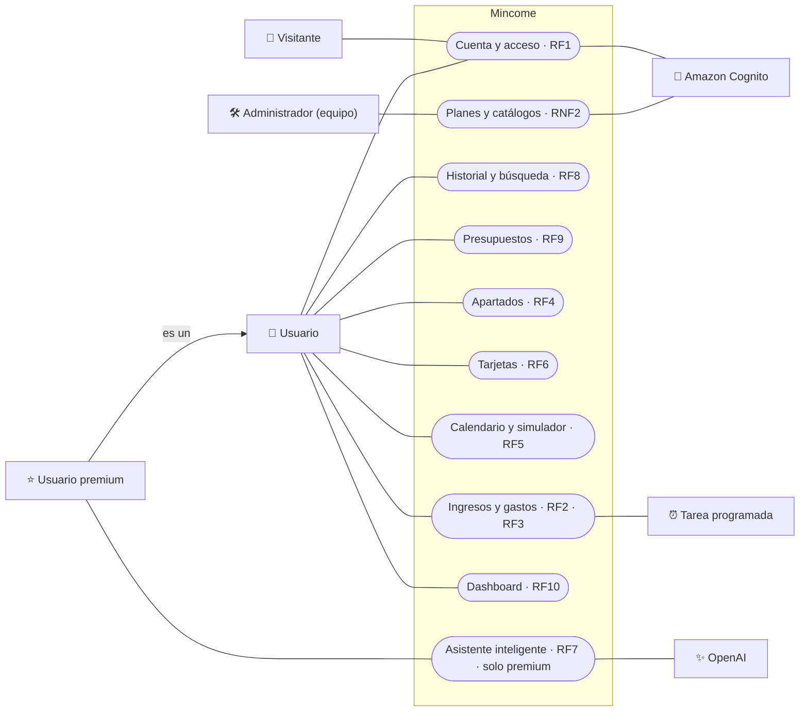

### Cuenta y acceso (RF1)

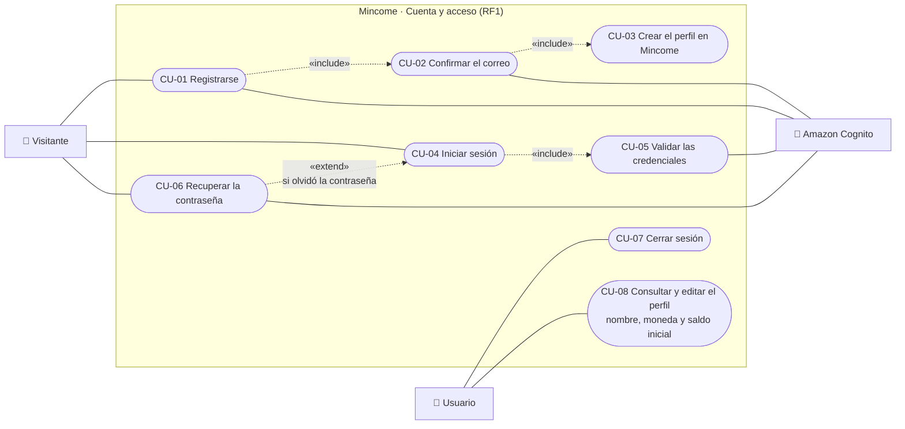

### Ingresos y gastos (RF2, RF3)

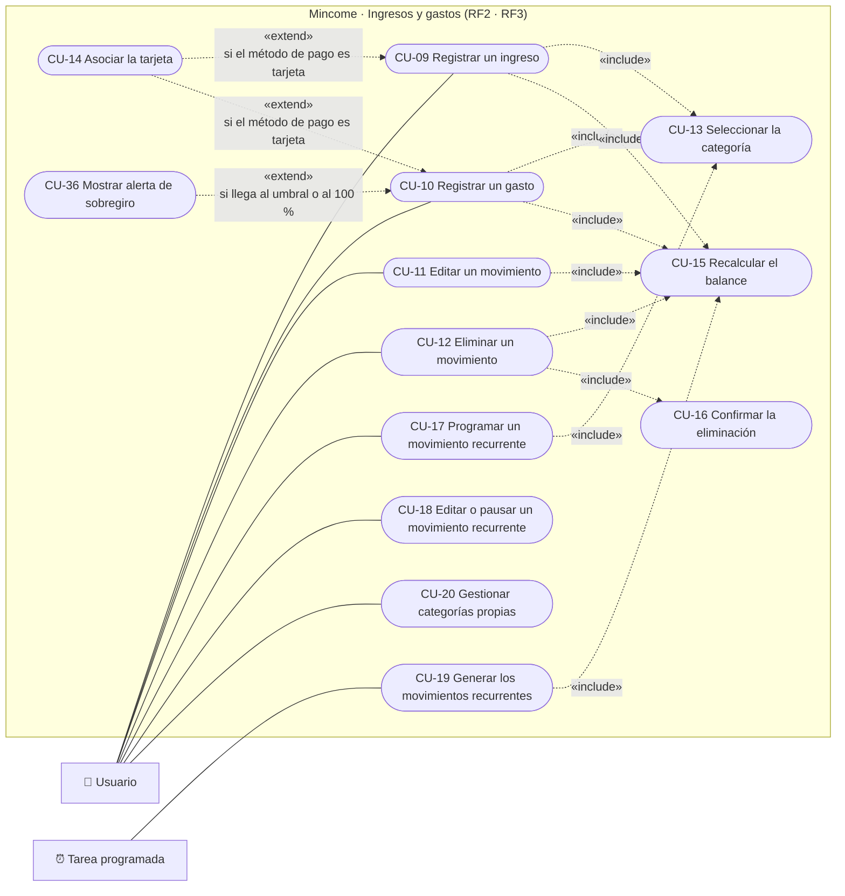

### Historial y búsqueda (RF8)

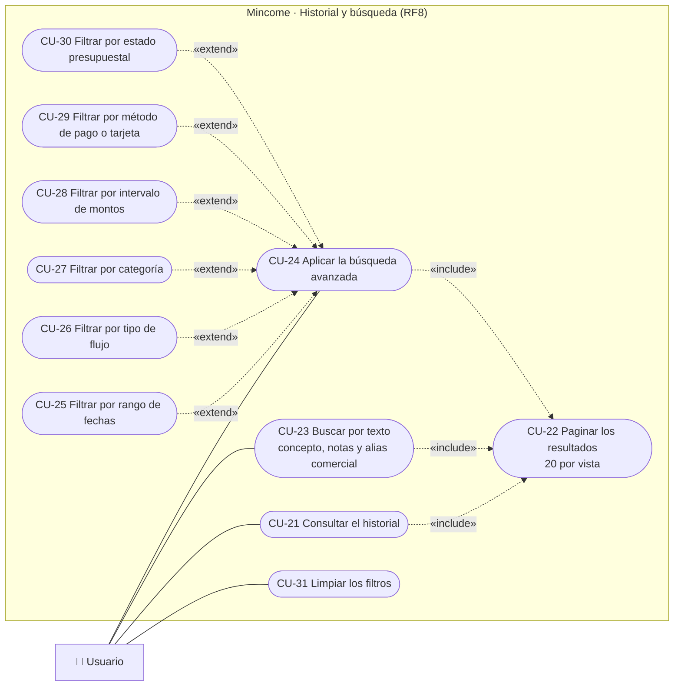

### Presupuestos (RF9)

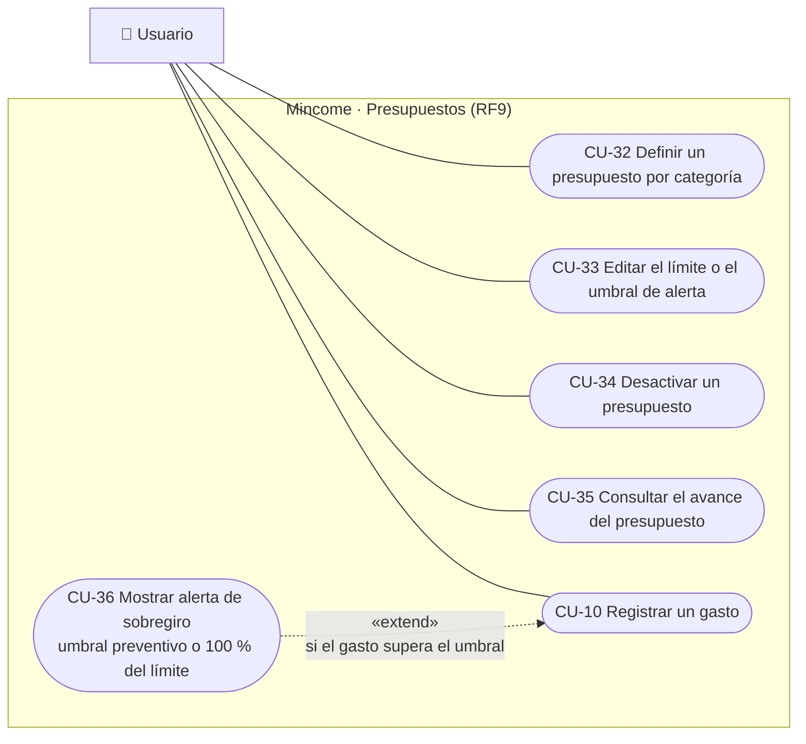

### Apartados (RF4)

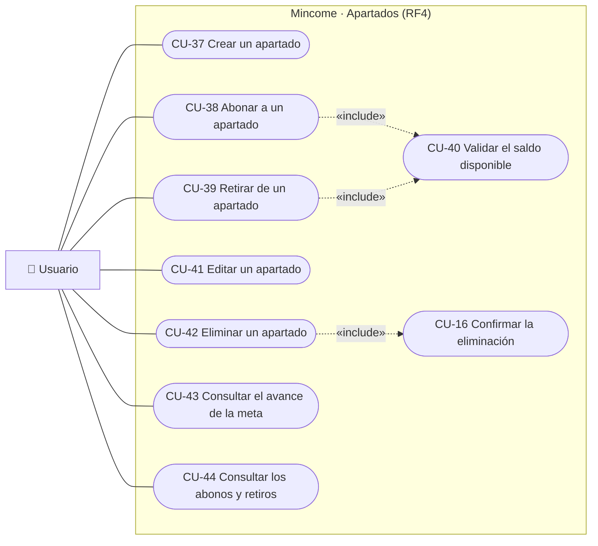

### Tarjetas (RF6)

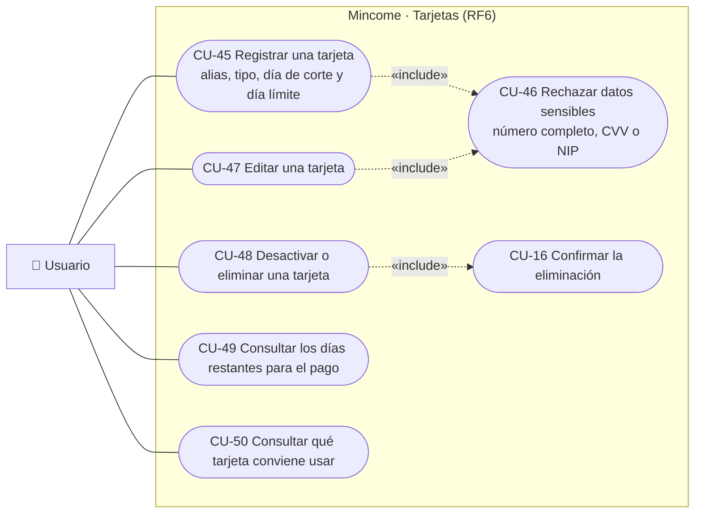

### Calendario y simulador (RF5)

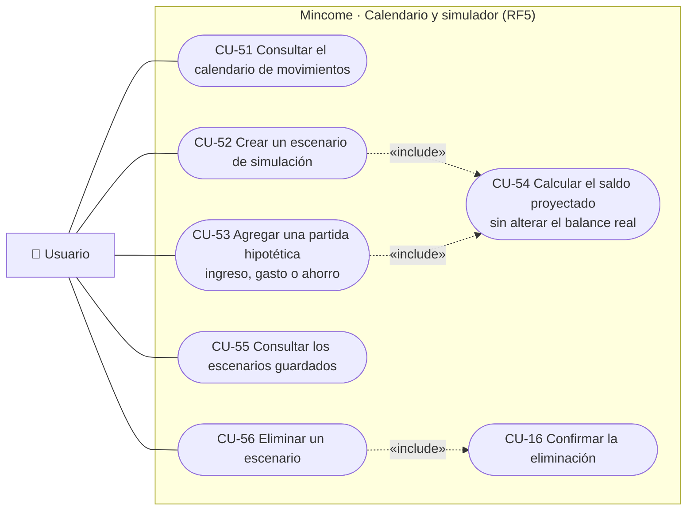

### Asistente inteligente (RF7, RNF2)

Solo el usuario premium usa el asistente. Al usuario gratuito, la app no le muestra el chat.

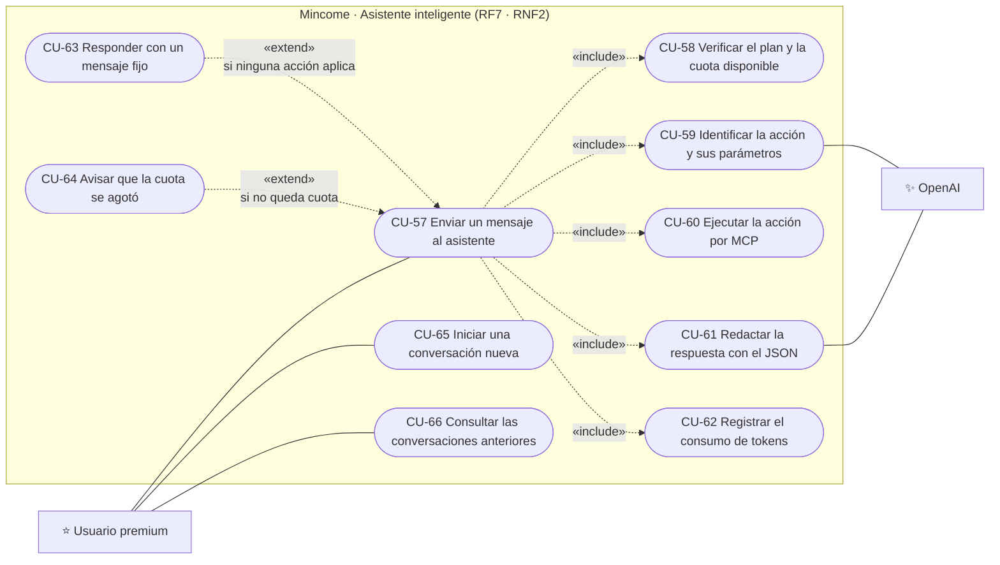

### Dashboard (RF10)

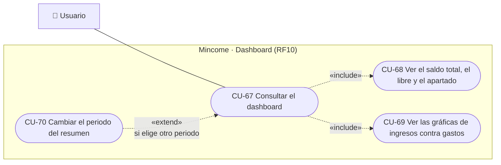

### Planes y catálogos (RNF2)

En el MVP no hay pagos: el equipo asigna el plan con un script que actualiza la base de datos y el grupo `premium` de Cognito en el mismo paso, para que nunca queden distintos. El usuario ve el cambio la próxima vez que se renueve su sesión, porque es cuando su JWT trae el grupo nuevo.

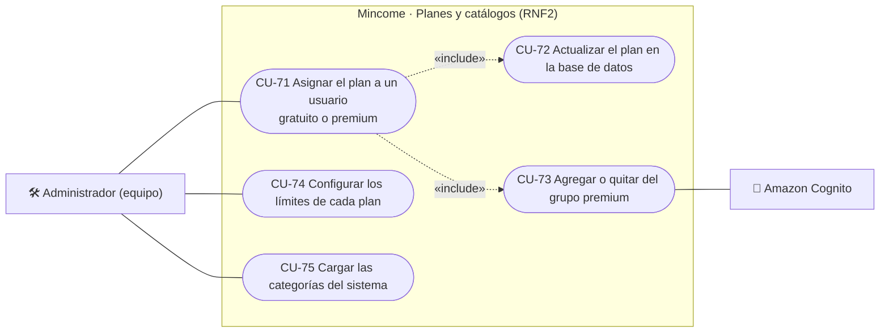

<a href="#-índice">⬆️ Volver al índice</a>

## 🚨 Análisis de riesgos

| ID | Riesgo | Nivel | Respuesta |
|:-:|---|:-:|:-:|
| R1 | Inconsistencias en saldos y proyecciones | 15 | Mitigar |
| R2 | Resistencia al cambio | 12 | Mitigar |
| R3 | Falta de registro de movimientos | 8 | Mitigar |
| R4 | Simulaciones imprecisas | 9 | Mitigar |
| R5 | Recomendaciones erróneas del chatbot | 20 | Mitigar |
| R6 | Incremento de costos de infraestructura e IA | 25 | Mitigar |
| R7 | Fugas de información financiera | 15 | Mitigar |
| R8 | Dificultad de integración de IA | 6 | Mitigar |
| R9 | Dependencia de servicios externos | 9 | Mitigar / Transferir |
| R10 | Problemas de rendimiento con grandes datos | 12 | Mitigar |
| R11 | Vulnerabilidad a inyección de código y comandos maliciosos | 10 | Mitigar |
| R12 | Secuestro o suplantación de sesiones de usuario | 15 | Mitigar |
| R13 | Agotamiento del grupo de conexiones a la base de datos (*Connection Pool Exhaustion*) | 12 | Mitigar |
| R14 | Incremento incontrolado de funciones y alcance previsto | 20 | Mitigar |
| R15 | Pérdida de base de datos | 10 | Mitigar |

<b>Ver descripción, consecuencias y justificación de cada riesgo</b>

 

| ID | Descripción | Consecuencias | Justificación |
|:-:|---|---|---|
| R1 | Errores en la lógica matemática al calcular ingresos, gastos simulados y balances futuros. | Cálculos incoherentes, pérdida de confianza en la herramienta y análisis erróneos generados por la IA. | Implementar pruebas unitarias en todas las operaciones aritméticas y validación estricta de tipos de datos de entrada. |
| R2 | Los usuarios están acostumbrados a sus hojas de cálculo, notas o apps habituales y rechazan el esfuerzo de adoptar una nueva plataforma. | Baja adopción de usuarios, que se resisten a migrar o cambiar su plataforma habitual de administración. | Ofrecer el chatbot como el valor distintivo de la plataforma: transforma el registro estático en un asistente proactivo que simula escenarios financieros interactivos. |
| R3 | Los usuarios no registran sus movimientos financieros de forma constante. | Información incompleta o incorrecta en los cálculos y reportes. | Diseñar una experiencia de captura rápida, recordatorios y notificaciones; hacer la experiencia fluida y rápida, agregando automatizaciones donde sea posible. |
| R4 | Las simulaciones financieras utilizan datos incompletos o erróneos. | Resultados poco precisos, proyecciones incorrectas y pérdida de credibilidad. | Validar datos de entrada en formularios, advertir sobre campos vacíos y mostrar una leyenda indicando que las proyecciones son estimaciones basadas en la información proporcionada por el usuario, ya que este puede hacer simulaciones o estimaciones a su propio interés. |
| R5 | El chatbot proporciona consejos o respuestas sobre temas no financieros ajenos al propósito de la plataforma. | El usuario puede tomar malas decisiones financieras y utilizar la aplicación para otros fines no previstos. | Limitar las recomendaciones a la información disponible y mostrar descargos de responsabilidad, con la leyenda "El CHATBOT es una IA y puede cometer errores." |
| R6 | Aumento inesperado en el consumo de recursos en la nube y llamadas a APIs de IA. | Sobrecostos operativos que superen el presupuesto del proyecto. | Control de consumo por plan: el asistente es exclusivo de las cuentas premium, con una asignación mensual de consultas y tokens y un tope de seguridad para evitar sobrecostos en las APIs del modelo de lenguaje. |
| R7 | Fugas o exposición de información financiera y personal de los usuarios. | Daño irreparable a la reputación, pérdida de confianza y problemas legales. | Cifrado de datos, control de acceso, autenticación segura y buenas prácticas de seguridad. Limitar la información que se pueda enviar al chatbot, asesoramiento y acuerdos de confidencialidad, términos y condiciones. |
| R8 | Dificultades puntuales para integrar modelos de IA, MCP o LangChain con el backend o la app. | Leves demoras o ajustes menores en la respuesta del asistente durante la fase de desarrollo. | Aprovechar la experiencia previa y conocimiento de los desarrolladores para asesorarse, realizar pruebas de concepto tempranas y mantener una arquitectura modular. |
| R9 | Dependencia de terceros (OpenAI): cambio de APIs o caída del servicio. | Interrupción del servicio y necesidad de reescribir partes del código. | Se transfiere la infraestructura y el mantenimiento del modelo al proveedor externo. |
| R10 | El sistema procesa grandes volúmenes de datos históricos de forma ineficiente. | Lentitud en la aplicación y mala experiencia de usuario. | Optimizar consultas, implementar índices y monitorear el rendimiento. |
| R11 | Inserción de sentencias no autorizadas (SQL injection, NoSQL injection o scripts) a través de los campos de entrada de la aplicación. | Alteración de consultas, manipulación indebida de datos, acceso no autorizado a registros o degradación del servicio. | Filtrar caracteres especiales y datos extraños en los campos de captura, asegurar que las consultas no ejecuten código del usuario y limitar los permisos de acceso al servidor de base de datos. |
| R12 | Almacenamiento inadecuado de tokens de autenticación o falta de expiración en sesiones inactivas. | Acceso no autorizado a perfiles ajenos, suplantación de identidad y pérdida de confidencialidad en simulaciones privadas. | Implementar tokens JWT firmados con expiración corta y almacenamiento seguro (cookies `HttpOnly` y `Secure`). |
| R13 | Consultas o transacciones que no liberan la conexión al terminar, o peticiones simultáneas que saturan el límite máximo del pool configurado. | Rechazo de nuevas solicitudes, errores de tiempo de espera (*Connection Timeout*) e indisponibilidad temporal del simulador. | Asegurar el cierre y liberación inmediata de cada conexión tras ejecutar una consulta, y reutilizar la misma instancia de conexión siempre que sea posible para ahorrar recursos. |
| R14 | Cambios y ajustes constantes en los requerimientos durante la fase de desarrollo. | Desviación del cronograma, presupuesto y sobrecarga de trabajo. | Ordenar las tareas de la más importante a la menos urgente y, si surge una función nueva, calcular cuántos días extra tomará para mover la fecha de entrega antes de empezar a programarla. |
| R15 | Pérdida de información por fallos en la base de datos o errores críticos de aplicación. | Pérdida total del historial de información de los usuarios y cese de operaciones. | Realizar respaldos periódicos y mecanismos de recuperación. |

<a href="#-índice">⬆️ Volver al índice</a>

## 🔄 Metodología y equipo

### Metodología: Scrum

Se eligió la **metodología ágil (framework Scrum)** por las características dinámicas del proyecto. Al requerir la entrega de un MVP centrado en la gestión de ingresos, gastos y un chatbot, Scrum permite dividir el trabajo en ciclos cortos o iteraciones (*sprints*). Esto facilita desarrollar de forma paralela la interfaz con Vite y la lógica con NestJS, y permite reaccionar rápido ante imprevistos técnicos o cambios en los requerimientos sin detener el progreso general del software.

### 👥 Roles y responsabilidades

| Integrante | Rol | Responsabilidades |
|---|---|---|
| **Víctor Raúl Hernández Mejía** | 🧭 Líder de equipo / Scrum Master 🏛️ Arquitecto de software 💻 Desarrollador | Gestión del proyecto y coordinación del equipo: organizar los sprints, asegurar el cumplimiento del cronograma, gestionar los recursos y eliminar obstáculos que impidan el avance de los desarrolladores. |
| **Valeria Elizabeth Zapata Ibarra** | 🎨 Desarrolladora Frontend y UI/UX | Construir la interfaz gráfica y la experiencia de usuario: diseño de pantallas, implementación del código del lado del cliente con React, Vite y TypeScript, y configuración de la responsividad visual para una experiencia multidispositivo óptima. |
| **Carlos Arizpe Hernández** | ⚙️ Desarrollador Backend y Arquitecto de IA | Lógica de negocio e infraestructura del servidor: programación en NestJS con TypeScript, desarrollo de la API propia para la comunicación entre componentes y orquestación del asistente inteligente con LangChain y el servidor MCP. |
| **Juan Francisco Montañez Díaz** | 🐘 Administrador de Base de Datos | Integridad, estructura y seguridad de la información: modelado de la base de datos para almacenar ingresos, gastos y apartados, y garantizar que no se almacene información sensible (como códigos CVV). |
| **Brayan Daniel Lafuente Monreal** | 🧪 QA Tester / Analista de Calidad | Diseñar y ejecutar pruebas para validar que la lógica del calendario y la simulación financiera sean precisas, y verificar que las respuestas y recomendaciones del chatbot operen sin errores antes de la entrega final. |

### 🧯 Plan de contingencia

| Escenario | Respuesta |
|---|---|
| 🙋 **Ausencia o baja de un integrante** | Programación en pares (*pair programming*) y documentación continua del código. Si un desarrollador se ausenta, otro miembro del equipo tendrá el conocimiento técnico necesario para asumir temporalmente sus módulos críticos. |
| ⏳ **Retrasos por complejidad técnica** | Si las funcionalidades de IA (servidor MCP o LangChain) consumen más tiempo del estimado, el equipo aislará el módulo problemático y enfocará todos los esfuerzos en estabilizar las funciones *core* (ingresos y gastos) para garantizar el MVP. |
| 💾 **Pérdida de información** | Control de versiones estricto (Git/GitHub) con respaldos diarios en repositorios remotos para asegurar que ninguna línea de código o avance se pierda por fallos de hardware. |

<a href="#-índice">⬆️ Volver al índice</a>

## 🐙 Control de versiones con GitHub

Usamos **GitHub** para alojar los repositorios del proyecto, revisar el código y desplegar.

| Motivo | Justificación |
|---|---|
| 🎓 **GitHub Student Developer Pack** | Como estudiantes tenemos GitHub Pro y GitHub Copilot sin costo, así que la plataforma no le suma gastos al proyecto. |
| 🤝 **Es lo que el equipo ya conoce** | Todos lo hemos usado antes, así que no perdemos tiempo del cuatrimestre aprendiendo otra plataforma y empezamos a trabajar desde el primer sprint. |
| 🔀 **Todo el flujo en un solo lugar** | Repositorios, pull requests con revisión obligatoria y ramas protegidas para `main` y `develop`. |
| 🚀 **CI/CD con GitHub Actions** | Corre lint, pruebas y despliegue a AWS en cada PR, conectándose por OIDC, sin llaves de AWS en el repositorio. |
| 🎫 **Integración con Jira** | Con la app GitHub for Jira, cada rama, commit y PR aparece en su ticket del tablero. |

Las reglas de ramas, commits y pull requests están en la [guía de contribución](CONTRIBUTING.md).

<a href="#-índice">⬆️ Volver al índice</a>

## ✅ Separación en tareas

| ID | Tarea | Requisitos | Responsable | Esfuerzo | Depende de |
|:-:|---|---|---|:-:|---|
| TSK-01 | Configuración del entorno base y persistencia | RNF1, RNF5 | Carlos Arizpe / Juan Francisco | 5 SP | — |
| TSK-02 | Módulo de autenticación y seguridad en backend | RF1, RNF3 | Carlos Arizpe | 5 SP | TSK-01 |
| TSK-03 | Vistas de autenticación y gestión de acceso | RF1, RNF7 | Valeria Zapata | 3 SP | TSK-02 |
| TSK-04 | Modelado relacional y lógica transaccional | RF2, RF3, RNF5 | Juan Francisco / Carlos Arizpe | 8 SP | TSK-01 |
| TSK-05 | Módulo lógico de apartados financieros | RF4, RNF5 | Juan Francisco | 5 SP | TSK-04 |
| TSK-06 | Administración de tarjetas y fechas de corte | RF6, RNF3 | Juan Francisco / Carlos Arizpe | 5 SP | TSK-01 |
| TSK-07 | Motor de presupuestos y alertas de consumo | RF9, RNF5 | Carlos Arizpe | 5 SP | TSK-04 |
| TSK-08 | Motor de calendario y simulaciones libres | RF5 | Carlos Arizpe | 8 SP | TSK-04, TSK-06 |
| TSK-09 | Orquestación de IA y servidor MCP | RF7, RNF2 | Carlos Arizpe | 13 SP | TSK-04, TSK-08 |
| TSK-10 | Mecanismo de búsqueda avanzada y filtrado | RF8, RNF5 | Juan Francisco / Carlos Arizpe | 5 SP | TSK-04 |
| TSK-11 | Desarrollo del Dashboard y resumen visual | RF10, RNF6, RNF7 | Valeria Zapata | 8 SP | TSK-03, TSK-04 |
| TSK-12 | Interfaces de apartados, calendario y tarjetas | RF4, RF5, RF6 | Valeria Zapata | 8 SP | TSK-05, TSK-06, TSK-08 |
| TSK-13 | Componente visual del asistente virtual (chatbot) | RF7, RNF7 | Valeria Zapata | 5 SP | TSK-09 |
| TSK-14 | Infraestructura de despliegue en la nube (AWS) | RNF4 | Víctor Hernández / Carlos Arizpe | 5 SP | TSK-11 |
| TSK-15 | Diseño y ejecución de matriz de pruebas QA | RNF3, RNF5 | Brayan Daniel Lafuente | 8 SP | TSK-07, TSK-08, TSK-10, TSK-12 |
| TSK-16 | Evaluación de calidad y límites del asistente IA | RF7 | Brayan Daniel Lafuente | 5 SP | TSK-09, TSK-13 |
| TSK-17 | Supervisión de sprints y aseguramiento metodológico | RNF1 a RNF7 | Víctor Hernández | 5 SP | Todas las anteriores |
| | | | | **106 SP** | |

<b>Ver descripción y Definition of Done de cada tarea</b>

 

| ID | Descripción | Criterio de terminado (DoD) |
|:-:|---|---|
| TSK-01 | Inicialización del repositorio Git, estructuración modular del backend en NestJS con TypeScript y configuración del pool de conexiones hacia PostgreSQL. | Repositorio remoto con linter y tipado estricto activo, variables de entorno protegidas y script de migración inicial ejecutado con éxito. |
| TSK-02 | Integración del backend con Amazon Cognito: validación del JWT en API Gateway, creación del perfil en `usuarios` ligado a su `cognito_sub` y protección de todos los endpoints. | Registro e inicio de sesión funcionales con Cognito; toda petición sin un JWT válido se rechaza; el perfil del usuario se crea con su `cognito_sub` y la base de datos no guarda contraseñas. |
| TSK-03 | Maquetación e interactividad en Vite/TypeScript para las pantallas de Login y Registro. | Formularios con validación en cliente (correo, longitud de contraseña), retroalimentación de error legible y redirección al Dashboard al autenticarse. |
| TSK-04 | Diseño del esquema de base de datos para ingresos y gastos; endpoints CRUD con fechas históricas y categorías. | Tablas relacionales creadas; endpoints capaces de crear, listar, editar y eliminar movimientos, recalculando el balance de forma dinámica. |
| TSK-05 | Entidad de apartados y algoritmo de cálculo que aísla visualmente el saldo disponible sin modificar el patrimonio total. | Endpoints de apartados validados; pruebas de consistencia contable que comprueban que el saldo libre se reduce sin eliminar registros de capital. |
| TSK-06 | Módulo para registrar referencias de tarjetas (alias, día de corte, día límite de pago) excluyendo estrictamente campos CVV/NIP. | Entidad creada sin campos sensibles; servicio que calcula y retorna con exactitud aritmética los días restantes para la fecha límite de pago. |
| TSK-07 | Reglas de negocio para asociar límites mensuales a categorías y evaluar si el gasto supera el 80 % o 100 %. | Servicio que intercepta nuevos gastos por categoría y retorna alertas visuales en el payload de respuesta ante sobregiros presupuestales. |
| TSK-08 | Lógica para proyectar balances a fechas futuras y permitir inyección de montos hipotéticos sin alterar datos reales. | Función de simulación que proyecta saldos futuros a partir de recurrencias y variables temporales sin guardar registros temporales en la BD. |
| TSK-09 | Configuración de LangChain con servidor MCP para consultar registros financieros y emitir sugerencias sin acceso directo a BD. | Servidor MCP conectado en local/nube que procese consultas naturales sobre los registros del usuario sin exponer credenciales. |
| TSK-10 | Filtros combinados (texto, rangos de fecha, monto y categorías) y paginación en el servidor. | Consultas SQL con índices optimizados; resultados filtrados y paginados devueltos eficientemente en la API. |
| TSK-11 | Pantalla principal en Vite con indicadores, resúmenes estadísticos y reactividad de datos. | Interfaz responsiva que renderiza el balance general y actualiza tarjetas estadísticas en tiempo real tras cualquier cambio en transacciones. |
| TSK-12 | Vistas e interacción para distribuir fondos en apartados, usar el calendario y consultar tarjetas. | Vistas responsivas enlazadas a sus endpoints, con selector de fechas, simulación interactiva y visualización de días de corte. |
| TSK-13 | Ventana de chat conversacional integrada al cliente web con control de estados y feedback. | Interfaz de chat integrada en la navegación con scroll dinámico, indicador de carga activo y manejo de errores por caída del servicio. |
| TSK-14 | Bucket en Amazon S3, distribución por Amazon CloudFront con SSL/TLS y Origin Access Control (OAC). | Frontend desplegado con compilación estática optimizada de Vite, accesible bajo HTTPS en CDN de alta disponibilidad. |
| TSK-15 | Pruebas funcionales de formularios, consistencia en cálculos aritméticos y validación de seguridad (OWASP). | Matriz de pruebas ejecutada al 100 %; validación de ausencia de CVV en BD y reporte de errores resueltos previo a la entrega. |
| TSK-16 | Casos de prueba para medir latencia, precisión de sugerencias y resistencia ante entradas fuera de contexto. | Batería de prompts ejecutada; verificación de avisos legales ("El chatbot es una IA y puede equivocarse") y estabilidad en respuestas. |
| TSK-17 | Gestión del tablero Scrum, remoción de impedimentos, control de tiempos y revisión de entregables por hito. | Tablero actualizado en cada sprint, actas de acuerdos de equipo y versión final validada para entrega institucional. |

<b>Ver diagrama de dependencias</b>

 

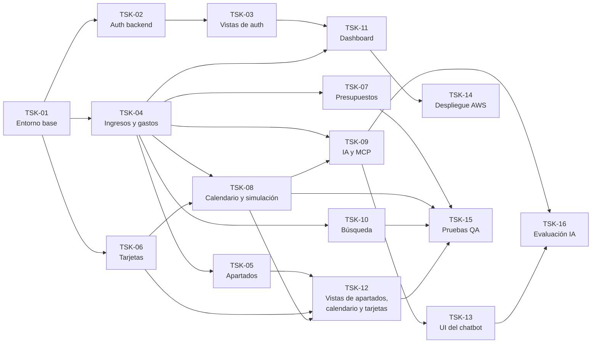

TSK-17 (supervisión de sprints) depende de todas las tareas anteriores.

<a href="#-índice">⬆️ Volver al índice</a>

## 📅 Cronograma

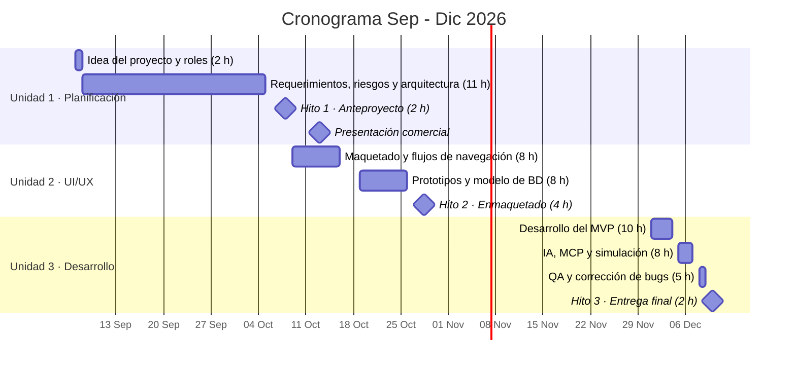

### Unidad 1 · Planificación y Anteproyecto
**Total: 15 horas · septiembre – octubre**

| Fecha | Horas | Actividad | Responsable |
|---|:-:|---|---|
| 07 sep 2026 | 2 h | Inicio de clases, definición de la idea del proyecto financiero y conformación de roles | Todos los integrantes |
| 08 sep – 05 oct 2026 | 11 h | Levantamiento de requerimientos funcionales, análisis de riesgos y planeación de la arquitectura del software | Todos los integrantes |
| 🎯 **08 oct 2026** | 2 h | **Hito verificable 1:** entrega formal del documento de Anteproyecto finalizado y aprobado | Todos los integrantes |
| 13 oct 2026 | — | Presentación comercial | Todos los integrantes |

### Unidad 2 · Enmaquetado y Diseño UI/UX
**Total: 20 horas · 08 – 29 de octubre**

| Fecha | Horas | Actividad | Responsable |
|---|:-:|---|---|
| 09 – 16 oct 2026 | 8 h | Maquetado de interfaces visuales, estructuración de componentes UI y definición de flujos de navegación interactivos | Víctor Raúl, Valeria Zapata y Francisco Montañez |
| 19 – 26 oct 2026 | 8 h | Creación de prototipos interactivos de alta fidelidad y estructuración del modelo de la base de datos | Víctor Raúl, Valeria Zapata y Francisco Montañez |
| 🎯 **27 – 29 oct 2026** | 4 h | **Hito verificable 2:** ajustes finales, presentación del enmaquetado funcional y diseño de interfaces | Víctor Raúl, Valeria Zapata y Francisco Montañez |

### Unidad 3 · Desarrollo, Pruebas y Proyecto Final
**Total: 25 horas · 01 – 10 de diciembre**

| Fecha | Horas | Actividad | Responsable |
|---|:-:|---|---|
| 01 – 04 dic 2026 | 10 h | Desarrollo intensivo del código frontend (Vite), backend (NestJS) y conexión a la base de datos para el MVP | Víctor Raúl, Valeria Zapata y Francisco Montañez |
| 05 – 07 dic 2026 | 8 h | Integración del asistente inteligente, servidor MCP y lógica de simulación financiera | Todos los integrantes |
| 08 – 09 dic 2026 | 5 h | Fase de pruebas de calidad (QA), ejecución de casos de prueba y corrección de errores | Brayan Daniel Lafuente |
| 🎯 **10 dic 2026** | 2 h | **Hito verificable 3:** despliegue y entrega del Proyecto Final 100 % funcional | Todos los integrantes |

<a href="#-índice">⬆️ Volver al índice</a>

## 🧱 Arquitectura y tecnologías

Arquitectura **cliente-servidor desacoplada**, dividida en tres capas principales: una interfaz de usuario interactiva (frontend), una capa de lógica de negocio y seguridad (backend) comunicada mediante una API RESTful propia, y una capa de persistencia (base de datos relacional). Además, integra un **microservicio especializado** para la orquestación de la inteligencia artificial.

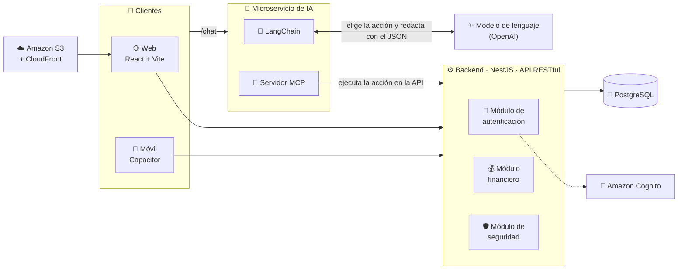

### ☁️ Infraestructura en AWS

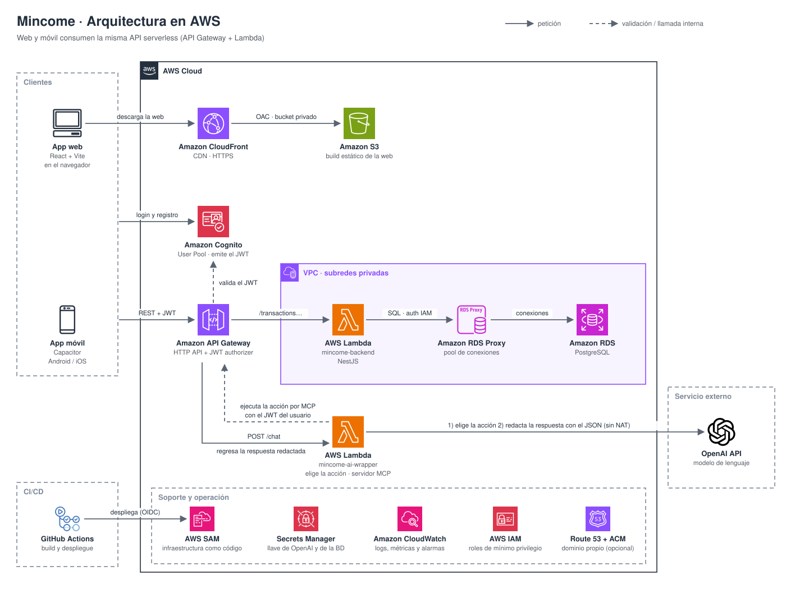

- **Web:** CloudFront sirve el build de React desde un bucket de S3 privado, al que solo CloudFront puede leer (OAC). La app móvil lleva su build dentro del paquete de Capacitor, así que no pasa por CloudFront.
- **Autenticación:** web y móvil inician sesión con Cognito y mandan el JWT en cada petición. API Gateway lo valida antes de invocar cualquier Lambda.
- **Plan premium:** los usuarios premium pertenecen al grupo `premium` de Cognito, así que su JWT ya trae el rol y la app muestra el asistente solo a ellos. La Lambda de IA vuelve a confirmar el plan y la cuota en la base de datos antes de llamar a OpenAI, porque `usuarios.plan_id` es la fuente de verdad.
- **Backend:** NestJS corre en una Lambda dentro de la VPC y se conecta a RDS PostgreSQL a través de RDS Proxy, que reutiliza las conexiones entre invocaciones para no agotar el pool.
- **IA:** el chat es un endpoint (`POST /chat`) que llega a la Lambda de `mincome-ai-wrapper`. La IA solo conoce las herramientas del servidor MCP y hace dos llamadas a OpenAI. En la primera identifica la acción y sus parámetros, y la ejecuta por MCP contra la API con el JWT del usuario, nunca directo en la base de datos (RNF2). En la segunda redacta la respuesta usando solo el JSON que regresó el endpoint. Si el mensaje no corresponde a ninguna acción, responde un mensaje fijo y no hace la segunda llamada. La Lambda está fuera de la VPC para llamar a OpenAI sin NAT Gateway.
- **Tareas programadas:** EventBridge Scheduler invoca una vez al día la Lambda del backend, que genera los movimientos de las plantillas de `transacciones_recurrentes` que vencen ese día.
- **Soporte:** las llaves viven en Secrets Manager, los logs y alarmas en CloudWatch, y todo se despliega con AWS SAM desde GitHub Actions usando OIDC, sin llaves de AWS en el repositorio.

### 🧰 Tecnologías elegidas

| Capa | Tecnología | Justificación |
|---|---|---|
| **Lenguaje** | TypeScript | Tipado estático y explícito: detecta errores desde que se programa y no cuando la app ya está corriendo, asegura que los datos recibidos en las APIs coincidan exactamente con la base de datos y mantiene el código ordenado y autodocumentado al trabajar en equipo. |
| **Frontend web** | React + Vite | Optimiza los tiempos de respuesta del navegador y permite la manipulación dinámica de calendarios interactivos, gráficas y simulaciones en tiempo real sin recargar la página. |
| **Aplicación móvil** | Capacitor | Aloja la solución web en un WebView nativo optimizado, reutilizando el 100 % de los componentes visuales responsivos, la lógica de negocio y las interfaces en TypeScript, y consumiendo la misma API en NestJS sin duplicar el desarrollo ni mantener dos códigos fuente. |
| **Backend** | NestJS (Node.js) | La gestión y consistencia del dinero (RF2, RF3, RF4, RF9) requiere un sistema robusto y seguro. Su arquitectura modular separa limpiamente el módulo de autenticación (RF1), el módulo financiero y el módulo de seguridad, con compatibilidad nativa con TypeScript. |
| **Autenticación** | Amazon Cognito | Registro e inicio de sesión de usuarios (RF1). |
| **Cómputo del backend** | AWS Lambda + Amazon API Gateway | Cobro por uso y escalado automático, sin servidores que administrar. API Gateway valida el JWT de Cognito antes de invocar las Lambdas. |
| **Base de datos** | PostgreSQL en Amazon RDS + RDS Proxy | Garantiza las propiedades ACID para balances contables e historiales transaccionales, evita inconsistencias durante consultas y filtrados masivos (RF8, RNF5) y permite un modelado estricto de tablas para no almacenar CVV ni NIP (RNF3). |
| **IA · Orquestación** | LangChain | Interpreta el mensaje del usuario, elige qué herramienta MCP ejecutar y con qué parámetros, y redacta la respuesta solo con los datos que regresa el endpoint (RF7). |
| **IA · Contexto** | Servidor MCP | Seguridad y desacoplamiento arquitectónico (RNF2): permite que el modelo de lenguaje interactúe de forma controlada con el contexto financiero del usuario, sin acceso directo o no autorizado a la base de datos central. |
| **Infraestructura web** | Amazon S3 + CloudFront | Alta disponibilidad y distribución segura por CDN (RNF4). |
| **Control de versiones y CI/CD** | GitHub + GitHub Actions | Tenemos GitHub Student Developer Pack y es la plataforma que el equipo ya conoce. El detalle está en [Control de versiones con GitHub](#-control-de-versiones-con-github). |

### 🚀 Despliegue

- **Web:** Amazon S3 y Amazon CloudFront (RNF4).
- **Backend e IA:** funciones de AWS Lambda detrás de Amazon API Gateway, desplegadas con AWS SAM desde GitHub Actions.
- **Base de datos:** Amazon RDS for PostgreSQL en subredes privadas, con RDS Proxy.
- **Móvil:** empaquetado de los artefactos generados por Capacitor para su instalación directa en dispositivos móviles.

<a href="#-índice">⬆️ Volver al índice</a>

## 🧩 Patrones de diseño

| Categoría | Patrón | Problema que resuelve | Aplicación en el proyecto |
|---|---|---|---|
| 🏭 Creacional | **Singleton** | Instanciar múltiples conexiones o clientes cognitivos por petición saturaría la memoria del servidor y agotaría el pool de conexiones (R6, R13). | La conexión al pool de PostgreSQL y las instancias de LangChain se gestionan como instancia única mediante la inyección de dependencias nativa de NestJS. |
| 🏭 Creacional | **Factory Method** | Distintos tipos de movimientos (ingresos fijos, ingresos variables, gastos generales, recurrentes y traspasos a apartados) comparten atributos base pero tienen reglas de validación y cálculos temporales diferentes. | Fábrica en la capa de servicios del backend que encapsula la instanciación de cada tipo de transacción sin acoplar los controladores a clases concretas. |
| 🧱 Estructural | **Repository** | Aislar la lógica matemática contable de la capa de persistencia, de modo que optimizar consultas o migrar la base de datos no afecte el cálculo de saldos y presupuestos. | Intermediario entre los controladores de NestJS y las tablas de PostgreSQL que centraliza lectura, escritura y paginación de historiales para web y móvil. |
| 🧱 Estructural | **Facade** | El flujo del chatbot (captura del mensaje, estructuración del prompt en LangChain, validación de permisos de contexto y comunicación mediante MCP) ensuciaría los controladores. | Servicio `ChatbotFacade` con una interfaz simple, `processQuery()`, que oculta toda la orquestación del servidor MCP y los modelos de lenguaje. |
| 🧱 Estructural | **Adapter** | Web y móvil persisten sesiones con mecanismos distintos (LocalStorage en el navegador vs. almacenamiento seguro del dispositivo con Capacitor). | Capa adaptadora de almacenamiento de sesión y consumo de API en el cliente que unifica la interfaz de llamada y permite compartir la lógica de pantallas. |
| 🔁 Comportamiento | **Observer** | Al registrar un gasto, ingreso o apartado, el balance total, la gráfica de resumen, el presupuesto de la categoría y el calendario deben enterarse de inmediato sin recargar la pantalla. | Gestión del estado global en los clientes: al confirmarse una transacción, los componentes suscritos se actualizan automáticamente en tiempo real. |
| 🔁 Comportamiento | **Strategy** | El asistente y el simulador ejecutan algoritmos distintos (proyectar balance, analizar sobregiros, recomendar uso de tarjetas); resolverlo con `if`/`switch` extensos generaría código frágil. | Interfaz de estrategia común que selecciona dinámicamente el algoritmo y las herramientas de contexto según la consulta en lenguaje natural. |

<a href="#-índice">⬆️ Volver al índice</a>

## 📐 Wireframes y flujo de navegación

La plataforma web centraliza su operación en el **Dashboard (RF10)**, accesible tras validar credenciales en **Acceso y Registro (RF1)**. Un menú lateral fijo (*sidebar*) permite acceder directamente a los módulos secundarios y regresar sin recargar datos ni perder la sesión.

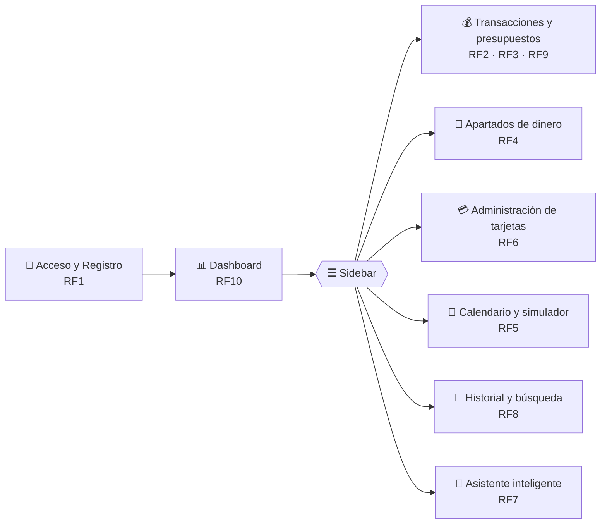

| # | Pantalla | Propósito | Diseño web |
|:-:|---|---|---|
| 1 | 🔐 **Acceso y Registro** (RF1) | Autenticación segura y validación local de datos para evitar envíos erróneos. | Panel central amplio con campos de captura y alternador para "Iniciar sesión" o "Registrarse". |
| 2 | 📊 **Dashboard General** (RF10) | Resumen visual interactivo con recálculo automático al modificar transacciones. | Aprovecha el ancho del monitor distribuyendo en multicolumna las tarjetas de métricas (Saldo, Apartados) y las gráficas dinámicas de ingresos vs. gastos. |
| 3 | 💰 **Transacciones y Presupuestos** (RF2, RF3, RF9) | Captura ágil de ingresos y gastos y vigilancia de presupuestos. | Panel extendido con selectores claros y una barra de progreso que despliega alertas visuales preventivas al alcanzar el 80 % o 100 % del límite. |
| 4 | 🐷 **Apartados de Capital** (RF4) | Creación de bolsillos virtuales para metas, aislando el saldo libre sin alterar el patrimonio total. | Cuadrícula (*grid*) de tarjetas con controles directos de abono y retiro, validados contra el saldo disponible. |
| 5 | 📅 **Calendario y Simulador** (RF5) | Monitoreo de pagos y proyección de liquidez futura. | Cuadrícula de calendario mensual expandida que permite inyectar montos ficticios reactivos en un panel lateral, sin afectar la base de datos real. |
| 6 | 💳 **Administración de Tarjetas** (RF6) | Control centralizado de fechas de corte y días límite de pago. | Tarjetas visuales esquemáticas en cuadrícula con contador de días restantes. Se prohíbe capturar CVV o NIP. |
| 7 | 🔎 **Historial y Búsqueda** (RF8) | Auditoría dinámica de transacciones. | Barra de búsqueda superior con un panel de filtros avanzados siempre visible (fechas, montos, categorías). |
| 8 | 🤖 **Asistente Inteligente** (RF7) | Interacción en lenguaje natural para consultas financieras. | Ventana de chat optimizada (panel persistente superior o modal) con indicador de carga y notificaciones sobre la cuota de tokens. |

<a href="#-índice">⬆️ Volver al índice</a>

## 🔎 Búsquedas en el sitio

Para optimizar la auditoría de movimientos y la recuperación rápida de transacciones históricas en web y móvil, el sistema implementa dos modalidades: **búsqueda simple predictiva** y **búsqueda avanzada multicriterio**.

### Búsqueda simple

Campo de texto libre en la cabecera del módulo de historial transaccional. Consulta en tiempo real coincidencias sobre el **concepto**, las **notas adicionales** y el **alias comercial** del registro (por ejemplo: "Supermercado", "Pago de luz" o "Honorarios").

- ⏱️ **Debounce de 300 ms:** la petición a la API RESTful se pospone hasta que el usuario concluye la escritura, evitando sobrecarga del servidor y bloqueos en la interfaz.
- 🔡 **Sin distinción de mayúsculas:** el backend ejecuta coincidencias parciales (`ILIKE`) en PostgreSQL, sin exigir coincidencia exacta de mayúsculas, minúsculas o acentos.

### Búsqueda avanzada (multicriterio)

| Filtro | Opciones |
|---|---|
| 📆 **Rango temporal** | Accesos rápidos de un clic: semana en curso, mes actual, último trimestre y ejercicio fiscal. Intervalo personalizado con fecha de inicio y fecha de fin, validadas para que la inicial no sea posterior a la final. |
| 🔀 **Tipo de flujo financiero** | Todos, ingresos recurrentes, ingresos variables, gastos fijos, gastos variables y transferencias hacia apartados virtuales. |
| 🏷️ **Categorización contable** | Selector múltiple: Alimentación, Transporte, Vivienda, Servicios, Salud, Entretenimiento, Educación y Ahorro. |
| 💲 **Intervalo de importes** | Monto mínimo y monto máximo configurables. |
| 💳 **Método de pago y cuentas** | Alias de tarjetas de crédito o débito registradas, transferencias y pagos en efectivo (sin información bancaria confidencial). |
| 🚦 **Estado presupuestal** | Filtro booleano para aislar los gastos que activaron alertas por llegar al umbral preventivo (80 % por defecto) o al 100 % del límite mensual de su categoría. |

### Comportamiento y paginación en servidor

- 📄 **Paginación eficiente:** las consultas se resuelven en PostgreSQL con `LIMIT` y `OFFSET`, en bloques de **20 registros por vista**, minimizando el consumo de datos móviles y la memoria del cliente.
- 📌 **Persistencia de filtros:** en web, los parámetros se guardan en la URL (*query params*) para recargar sin perder el estado; en móvil, se mantienen sincronizados en el estado global de la sesión.
- 🧹 **Restablecimiento rápido:** el control "Limpiar filtros" restaura la vista general a los movimientos del mes en curso con una sola interacción.

<a href="#-índice">⬆️ Volver al índice</a>

## 🔐 Validación de la información

### 🖥️ Frontend (web y móvil)

Validaciones inmediatas en el cliente para dar retroalimentación al interactuar con los formularios y evitar envíos incompletos.

| Tipo | Regla |
|---|---|
| **Datos obligatorios** | Movimientos: monto, fecha, tipo de flujo (ingreso o gasto) y categoría. Creación de cuenta: correo y contraseña. Tarjetas: alias, día de corte y día límite de pago. Los campos vacíos muestran advertencias en color visible con mensajes explicativos, y el botón de envío permanece deshabilitado hasta completarlos. |
| **Formatos de entrada** | Montos: valores numéricos positivos con máximo dos decimales, sin signos negativos, letras ni ceros. Fechas: selectores gráficos de calendario. Días de corte y pago: enteros del 1 al 31. |
| **Expresiones regulares** | Correo: nombre de usuario, arroba (@), dominio y extensión válida. Contraseña: mínimo 8 caracteres con al menos una mayúscula, una minúscula, un número y un símbolo especial. |
| **Campos de confirmación** | Repetir la contraseña en el registro, verificando en tiempo real que coincidan. Ventana de confirmación al eliminar transacciones, apartados o tarjetas para prevenir borrados accidentales. |

> **Justificación:** ofrece una experiencia ágil con avisos visuales instantáneos, previene equivocaciones evidentes en la captura y ahorra consumo de red al no enviar solicitudes incompletas al servidor.

### ⚙️ Backend (NestJS)

Como las validaciones de la interfaz pueden evadirse o modificarse, el servidor aplica reglas estrictas antes de persistir cualquier registro en PostgreSQL.

| Tipo | Regla |
|---|---|
| **Datos únicos** | Al dar de alta un usuario, se comprueba que el correo no exista previamente. Los alias de tarjetas y apartados no se repiten dentro de la cuenta del mismo usuario. |
| **Coherencia de la información** | La cantidad destinada a un apartado nunca excede el dinero libre disponible. En consultas y filtros, la fecha inicial no puede ser posterior a la final. Se verifica la coherencia entre el día de corte y la fecha límite de pago. Al registrar un egreso, se evalúa el acumulado de la categoría para emitir las alertas del 80 % y 100 %. |
| **Formato y seguridad** | Se descarta cualquier atributo que no corresponda al contrato de la petición. Se bloquea cualquier intento de registrar números completos de tarjeta, CVV o NIP. Las consultas usan sentencias parametrizadas contra inyección SQL. |

> **Justificación:** garantiza la seguridad y la consistencia matemática de los datos contables, previene fraudes o alteraciones de saldo y protege la estabilidad de la base de datos y de las consultas del asistente inteligente.

<a href="#-índice">⬆️ Volver al índice</a>

## 🎨 Definición de contenido

### 1. Textos

| Tipo | Uso | Ejemplos |
|---|---|---|
| **Microcopia de navegación y acciones** | Botones y enlaces con verbos directos | "Iniciar sesión", "Guardar movimiento", "Crear apartado", "Simular proyección", "Limpiar filtros" |
| **Etiquetas y ayudas en formularios** | Indicadores breves con *placeholders* descriptivos | "Monto ($)", "Categoría contable", "Día de corte (1-31)", "Alias de la tarjeta" |
| ✅ **Confirmación de éxito** | Mensajes del sistema | "Movimiento registrado correctamente", "Apartado actualizado con éxito" |
| ⚠️ **Advertencias de presupuesto** | Mensajes del sistema | "Atención: Has superado el 80% de tu límite presupuestal en esta categoría", "Límite mensual alcanzado (100%)" |
| ❌ **Errores de validación** | Mensajes del sistema | "El importe ingresado debe ser mayor a cero", "La fecha inicial no puede ser posterior a la fecha final" |

> [!WARNING]
> **Aviso legal del asistente:** El Asistente es una inteligencia artificial orientada a la estimación y apoyo personal; sus sugerencias no constituyen asesoría financiera legal ni contable certificada.

### 2. Tono y voz

- **Plataforma:** claro, empático, sobrio y profesional. Evita tecnicismos contables innecesarios o jerga informal, para usuarios con distintos niveles de educación financiera.
- **Chatbot:** orientativo, objetivo y motivador. Explica análisis cuantitativos en lenguaje natural de forma comprensible y prudente, sin emitir juicios de valor sobre los hábitos de compra ni sugerir decisiones de inversión de alto riesgo.

### 3. Tipografía

Fuente **sans-serif** de libre distribución (**Inter** o la familia del sistema **Roboto / System UI**), elegida por su claridad en caracteres numéricos y legibilidad en móviles.

| Elemento | Peso |
|---|---|
| Títulos principales (H1 / encabezados de vista) | Semi-bold · 600 |
| Subtítulos y tarjetas métricas (H2 / H3) | Medium · 500 |
| Cuerpo de texto y tablas | Regular · 400 |
| Microcopia y notas | Regular, con escala visual reducida |

### 4. Recursos gráficos e iconografía

- **Iconos vectoriales SVG** (Lucide Icons o Material Icons), usados exclusivamente para clarificar acciones y categorías contables.
- **Gráficos estadísticos** (barras de ingresos vs. egresos, líneas temporales de saldo y barras de progreso presupuestal) generados con renderizado vectorial programático en el cliente, sin imágenes rasterizadas pesadas.
- **Ilustraciones de estado** esquemáticas y minimalistas para estados vacíos (por ejemplo: "Aún no tienes movimientos registrados este mes") y cabeceras de bienvenida.

### 5. Criterios de selección y licencias

- **Licenciamiento libre:** activos visuales, tipografías y librerías bajo licencias de código abierto permisivas (MIT, Apache 2.0 o SIL Open Font License).
- **Rendimiento:** iconos e ilustraciones en SVG e imágenes estáticas comprimidas en WebP para no elevar el peso de los paquetes distribuidos en la nube.
- **Privacidad visual:** no se usan logotipos comerciales ni elementos con derechos reservados de instituciones bancarias; las tarjetas se representan con gráficos neutrales y abstractos basados en colores y alias proporcionados por el usuario.

<a href="#-índice">⬆️ Volver al índice</a>

---

## 🗃️ Modelo entidad-relación y diccionario de datos

### Modelo entidad-relación

Las 14 entidades del sistema con sus atributos, llaves y relaciones. Cada relación se lee de izquierda a derecha con su verbo, por ejemplo: *un usuario registra cero o muchas transacciones*.

| Símbolo | Cardinalidad |
|:-:|---|
| `\|\|` | Exactamente uno |
| `o\|` | Cero o uno |
| `o{` | Cero o muchos |

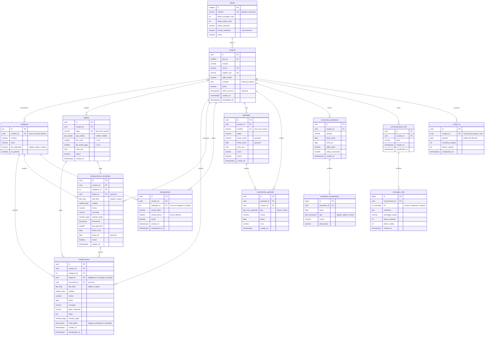

### Modelo físico (drawSQL)

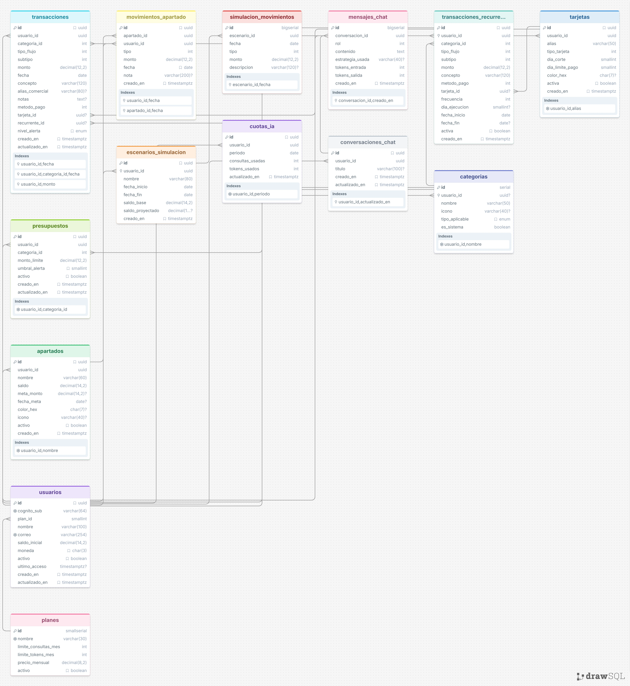

*Plataforma multiplataforma de finanzas personales · Base de datos relacional PostgreSQL · Cuatrimestre septiembre – diciembre 2026*

Estructura de la base de datos PostgreSQL: tipos enumerados y 14 tablas con sus campos, tipos, restricciones y llaves. Amazon Cognito gestiona la autenticación; por ello el esquema no guarda contraseñas ni sesiones, ni número de tarjeta, CVV o NIP.

Abreviaturas: **PK** llave primaria · **FK** llave foránea · **NN** no nulo · **UQ** único · **CK** CHECK · **DF** valor por defecto.

### Tipos enumerados

| Tipo | Valores permitidos | Uso |
| --- | --- | --- |
| `tipo_flujo` | `ingreso`, `gasto` | Naturaleza del movimiento |
| `subtipo_flujo` | `recurrente`, `variable`, `fijo` | Clasificación del flujo |
| `metodo_pago` | `efectivo`, `transferencia`, `tarjeta` | Medio del movimiento |
| `tipo_tarjeta` | `credito`, `debito` | Tipo de tarjeta |
| `frecuencia` | `semanal`, `quincenal`, `mensual`, `anual` | Periodicidad |
| `tipo_mov_apartado` | `abono`, `retiro` | Dirección del traspaso |
| `tipo_simulacion` | `ingreso`, `gasto`, `ahorro` | Partida hipotética |
| `rol_mensaje` | `usuario`, `asistente`, `sistema` | Emisor del mensaje |
| `nivel_alerta` | `ninguna`, `preventiva`, `excedida` | Alerta presupuestal que disparó un gasto |

### Diccionario de datos

#### `planes`

Catálogo de niveles de servicio y límites del asistente inteligente (RNF2).

| Campo | Tipo | Restricciones | Descripción |
| --- | --- | --- | --- |
| `id` | SMALLINT | PK, identidad | Identificador |
| `nombre` | VARCHAR(30) | NN, UQ | `gratuito` o `premium` |
| `limite_consultas_mes` | INT | NN, CK >= 0 | Consultas máximas por mes |
| `limite_tokens_mes` | INT | NN, CK >= 0 | Tokens máximos por mes |
| `precio_mensual` | NUMERIC(8,2) | NN, DF 0, CK >= 0 | Costo mensual |
| `incluye_asistente` | BOOLEAN | NN, DF false | Da acceso al asistente: `false` en `gratuito`, `true` en `premium` |
| `activo` | BOOLEAN | NN, DF true | Plan disponible |

#### `usuarios`

Perfil y datos de negocio de las cuentas registradas (RF1). Cognito gestiona credenciales y sesiones.

| Campo | Tipo | Restricciones | Descripción |
| --- | --- | --- | --- |
| `id` | UUID | PK | Identificador |
| `plan_id` | SMALLINT | NN, FK → `planes.id` | Plan vigente; se sincroniza con el grupo `premium` de Cognito |
| `nombre` | VARCHAR(100) | NN | Nombre para mostrar |
| `correo` | VARCHAR(254) | NN, UQ sobre `lower(correo)`, CK formato | Correo único |
| `cognito_sub` | VARCHAR(64) | NN, UQ | Identificador en Cognito |
| `saldo_inicial` | NUMERIC(14,2) | NN, DF 0 | Saldo inicial |
| `moneda` | CHAR(3) | NN, DF 'MXN' | Código ISO 4217 |
| `activo` | BOOLEAN | NN, DF true | Cuenta habilitada |
| `ultimo_acceso` | TIMESTAMPTZ | NULL | Último acceso exitoso |
| `creado_en` | TIMESTAMPTZ | NN, DF now() | Fecha de alta |
| `actualizado_en` | TIMESTAMPTZ | NN, DF now() | Última modificación |

#### `categorias`

Catálogo contable del sistema y de cada usuario.

| Campo | Tipo | Restricciones | Descripción |
| --- | --- | --- | --- |
| `id` | INT | PK, identidad | Identificador |
| `usuario_id` | UUID | NULL, FK → `usuarios.id` | Dueño; nulo para categorías del sistema |
| `nombre` | VARCHAR(50) | NN | Nombre |
| `icono` | VARCHAR(40) | NULL | Ícono SVG |
| `tipo_aplicable` | VARCHAR(10) | NN, CK IN ('ingreso','gasto','ambos') | Flujos permitidos |
| `es_sistema` | BOOLEAN | NN, DF false | Protegida contra edición o borrado |

Unicidad: índice sobre `(COALESCE(usuario_id, '00000000-0000-0000-0000-000000000000'::uuid), lower(nombre))`.

#### `tarjetas`

Referencias de tarjetas (RF6). **No** guarda número, CVV, NIP ni titular (RNF3).

| Campo | Tipo | Restricciones | Descripción |
| --- | --- | --- | --- |
| `id` | UUID | PK | Identificador |
| `usuario_id` | UUID | NN, FK → `usuarios.id` | Dueño |
| `alias` | VARCHAR(50) | NN, UQ con usuario_id | Nombre elegido |
| `tipo_tarjeta` | tipo_tarjeta | NN | Crédito o débito |
| `dia_corte` | SMALLINT | NN, CK BETWEEN 1 AND 31 | Día de corte |
| `dia_limite_pago` | SMALLINT | NN, CK BETWEEN 1 AND 31 | Día límite de pago |
| `color_hex` | CHAR(7) | NULL, CK `#RRGGBB` | Color neutral |
| `activa` | BOOLEAN | NN, DF true | Visible en el módulo |
| `creado_en` | TIMESTAMPTZ | NN, DF now() | Fecha de registro |

#### `transacciones_recurrentes`

Plantillas de ingresos o gastos que se repiten (RF2, RF3, RF5).

| Campo | Tipo | Restricciones | Descripción |
| --- | --- | --- | --- |
| `id` | UUID | PK | Identificador |
| `usuario_id` | UUID | NN, FK → `usuarios.id` | Dueño |
| `categoria_id` | INT | NN, FK → `categorias.id` | Categoría |
| `tipo_flujo` | tipo_flujo | NN | Ingreso o gasto |
| `subtipo` | subtipo_flujo | NN | Recurrente/fijo según el flujo |
| `monto` | NUMERIC(12,2) | NN, CK > 0 | Importe |
| `concepto` | VARCHAR(120) | NN | Descripción |
| `metodo_pago` | metodo_pago | NN | Medio habitual |
| `tarjeta_id` | UUID | NULL, FK → `tarjetas.id` | Tarjeta si aplica |
| `frecuencia` | frecuencia | NN | Periodicidad |
| `dia_ejecucion` | SMALLINT | NULL, CK BETWEEN 1 AND 31 | Día de ejecución |
| `fecha_inicio` | DATE | NN | Primera ocurrencia |
| `fecha_fin` | DATE | NULL, CK >= fecha_inicio | Última ocurrencia |
| `activa` | BOOLEAN | NN, DF true | Sigue generando movimientos |
| `creado_en` | TIMESTAMPTZ | NN, DF now() | Fecha de alta |

#### `transacciones`

Entidad central de ingresos y gastos reales (RF2, RF3, RF8).

| Campo | Tipo | Restricciones | Descripción |
| --- | --- | --- | --- |
| `id` | UUID | PK | Identificador |
| `usuario_id` | UUID | NN, FK → `usuarios.id` | Dueño |
| `categoria_id` | INT | NN, FK → `categorias.id` | Categoría |
| `tipo_flujo` | tipo_flujo | NN | Ingreso o gasto |
| `subtipo` | subtipo_flujo | NN, CK coherencia | Subtipo válido para el flujo |
| `monto` | NUMERIC(12,2) | NN, CK > 0 | Importe positivo |
| `fecha` | DATE | NN | Fecha del movimiento |
| `concepto` | VARCHAR(120) | NN | Concepto buscable |
| `alias_comercial` | VARCHAR(80) | NULL | Comercio u origen |
| `notas` | TEXT | NULL | Notas buscables |
| `metodo_pago` | metodo_pago | NN | Medio de pago |
| `tarjeta_id` | UUID | NULL, FK → `tarjetas.id` | Obligatoria con tarjeta |
| `recurrente_id` | UUID | NULL, FK → `transacciones_recurrentes.id` | Plantilla de origen |
| `nivel_alerta` | nivel_alerta | NN, DF 'ninguna' | Alerta que disparó: `preventiva` al llegar al `umbral_alerta` del presupuesto, `excedida` al llegar al 100 % |
| `creado_en` | TIMESTAMPTZ | NN, DF now() | Fecha de captura |
| `actualizado_en` | TIMESTAMPTZ | NN, DF now() | Última edición |

Restricciones: coherencia entre `tipo_flujo` y `subtipo`; si `metodo_pago = 'tarjeta'`, `tarjeta_id` es obligatorio.

#### `presupuestos`

Límite mensual de gasto por categoría (RF9).

| Campo | Tipo | Restricciones | Descripción |
| --- | --- | --- | --- |
| `id` | UUID | PK | Identificador |
| `usuario_id` | UUID | NN, FK → `usuarios.id` | Dueño |
| `categoria_id` | INT | NN, FK → `categorias.id` | Categoría vigilada |
| `monto_limite` | NUMERIC(12,2) | NN, CK > 0 | Tope mensual |
| `umbral_alerta` | SMALLINT | NN, DF 80, CK BETWEEN 1 AND 99 | Porcentaje preventivo |
| `activo` | BOOLEAN | NN, DF true | Presupuesto vigente |
| `creado_en` | TIMESTAMPTZ | NN, DF now() | Fecha de alta |
| `actualizado_en` | TIMESTAMPTZ | NN, DF now() | Última modificación |

Unicidad: `UQ (usuario_id, categoria_id)`.

#### `apartados`

Bolsillos virtuales de ahorro (RF4); no alteran el patrimonio total.

| Campo | Tipo | Restricciones | Descripción |
| --- | --- | --- | --- |
| `id` | UUID | PK | Identificador |
| `usuario_id` | UUID | NN, FK → `usuarios.id` | Dueño |
| `nombre` | VARCHAR(60) | NN, UQ con usuario_id | Nombre o meta |
| `saldo` | NUMERIC(14,2) | NN, DF 0, CK >= 0 | Dinero apartado |
| `meta_monto` | NUMERIC(14,2) | NULL, CK > 0 | Objetivo |
| `fecha_meta` | DATE | NULL | Fecha objetivo |
| `color_hex` | CHAR(7) | NULL | Color |
| `icono` | VARCHAR(40) | NULL | Ícono SVG |
| `activo` | BOOLEAN | NN, DF true | Apartado vigente |
| `creado_en` | TIMESTAMPTZ | NN, DF now() | Fecha de creación |

#### `movimientos_apartado`

Bitácora de abonos y retiros de los apartados.

| Campo | Tipo | Restricciones | Descripción |
| --- | --- | --- | --- |
| `id` | UUID | PK | Identificador |
| `apartado_id` | UUID | NN, FK → `apartados.id` | Apartado afectado |
| `usuario_id` | UUID | NN, FK → `usuarios.id` | Dueño |
| `tipo` | tipo_mov_apartado | NN | Abono o retiro |
| `monto` | NUMERIC(12,2) | NN, CK > 0 | Importe |
| `fecha` | DATE | NN, DF CURRENT_DATE | Fecha del traspaso |
| `nota` | VARCHAR(200) | NULL | Comentario |
| `creado_en` | TIMESTAMPTZ | NN, DF now() | Fecha de captura |

#### `escenarios_simulacion`

Escenarios hipotéticos guardados del calendario (RF5), aislados del balance real.

| Campo | Tipo | Restricciones | Descripción |
| --- | --- | --- | --- |
| `id` | UUID | PK | Identificador |
| `usuario_id` | UUID | NN, FK → `usuarios.id` | Dueño |
| `nombre` | VARCHAR(80) | NN | Nombre |
| `fecha_inicio` | DATE | NN | Inicio |
| `fecha_fin` | DATE | NN, CK >= fecha_inicio | Fin |
| `saldo_base` | NUMERIC(14,2) | NN | Saldo libre al crear |
| `saldo_proyectado` | NUMERIC(14,2) | NULL | Resultado calculado |
| `creado_en` | TIMESTAMPTZ | NN, DF now() | Fecha de creación |

#### `simulacion_movimientos`

Partidas ficticias dentro de un escenario.

| Campo | Tipo | Restricciones | Descripción |
| --- | --- | --- | --- |
| `id` | BIGINT | PK, identidad | Identificador |
| `escenario_id` | UUID | NN, FK → `escenarios_simulacion.id` | Escenario |
| `fecha` | DATE | NN | Día de la partida |
| `tipo` | tipo_simulacion | NN | Ingreso, gasto o ahorro |
| `monto` | NUMERIC(12,2) | NN, CK > 0 | Importe ficticio |
| `descripcion` | VARCHAR(120) | NULL | Descripción |

#### `conversaciones_chat`

Hilos del asistente inteligente (RF7).

| Campo | Tipo | Restricciones | Descripción |
| --- | --- | --- | --- |
| `id` | UUID | PK | Identificador |
| `usuario_id` | UUID | NN, FK → `usuarios.id` | Dueño |
| `titulo` | VARCHAR(100) | NULL | Título generado |
| `creado_en` | TIMESTAMPTZ | NN, DF now() | Inicio |
| `actualizado_en` | TIMESTAMPTZ | NN, DF now() | Último mensaje |

#### `mensajes_chat`

Mensajes intercambiados con el chatbot (LangChain + servidor MCP).

| Campo | Tipo | Restricciones | Descripción |
| --- | --- | --- | --- |
| `id` | BIGINT | PK, identidad | Identificador |
| `conversacion_id` | UUID | NN, FK → `conversaciones_chat.id` | Hilo |
| `rol` | rol_mensaje | NN | Emisor |
| `contenido` | TEXT | NN | Texto |
| `estrategia_usada` | VARCHAR(40) | NULL | Estrategia seleccionada |
| `tokens_entrada` | INT | NN, DF 0, CK >= 0 | Tokens del prompt |
| `tokens_salida` | INT | NN, DF 0, CK >= 0 | Tokens de respuesta |
| `creado_en` | TIMESTAMPTZ | NN, DF now() | Fecha del mensaje |

#### `cuotas_ia`

Consumo mensual del asistente por usuario (RNF2).

| Campo | Tipo | Restricciones | Descripción |
| --- | --- | --- | --- |
| `id` | UUID | PK | Identificador |
| `usuario_id` | UUID | NN, FK → `usuarios.id` | Usuario medido |
| `periodo` | DATE | NN | Primer día del mes |
| `consultas_usadas` | INT | NN, DF 0, CK >= 0 | Consultas realizadas |
| `tokens_usados` | INT | NN, DF 0, CK >= 0 | Tokens consumidos |
| `actualizado_en` | TIMESTAMPTZ | NN, DF now() | Última actualización |

Unicidad: `UQ (usuario_id, periodo)`. El tope aplicable se obtiene de `planes` mediante `usuarios.plan_id`.

<a href="#-índice">⬆️ Volver al índice</a>

**Mincome** · Cuatrimestre septiembre – diciembre 2026

<a href="#-mincome">⬆️ Volver arriba</a>

